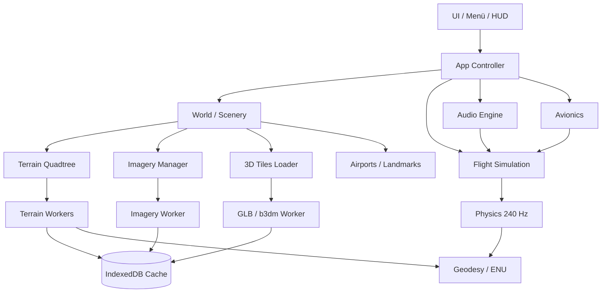

# Trapanotto Flight Simulator

## Produkt- und Technikkonzept v1.0

> **Status:** Phase 1 (Welt-Engine) live · **Datum:** 24.10.2026
> **Ziel:** Der beste browserbasierte Schweiz-Flugsimulator mit echten swisstopo-Daten,
> Three.js-Rendering, Blender-Assets und GitHub-Pages-Deployment.
> **Arbeitstitel:** „Trapanotto Flight Simulator“ (TFS)
> **Claim:** *Die Schweiz aus der Luft.*

---

## 0. Dokumentzweck

Dieses Dokument ist die verbindliche Produkt- und Technikspezifikation für den
Trapanotto Flight Simulator. Es beschreibt Vision, Scope, Datenquellen,
Architektur, Flugmodell, Asset-Pipeline, Qualitätsziele, Roadmap und Risiken.

Jeder Meilenstein endet mit einem deploybaren GitHub-Pages-Build. Änderungen am
Scope werden als ADR (Architecture Decision Record) in `docs/adr/` festgehalten.

**Leitprinzip:** Maximaler Anspruch, ehrlicher Scope. Wir bauen keinen
1:1-Nachbau von Microsoft Flight Simulator 2024 — wir bauen den besten
**Browser-Simulator für die Schweiz**, mit MSFS-ähnlicher Erfahrung,
echten Geodaten und sofortiger Verfügbarkeit ohne Installation.

---

## 1. Vision

Stell dir vor, du öffnest einen Link und stehst 20 Sekunden später auf der
Piste in Zürich. Kein Launcher, kein 200-GB-Download, keine Installation.
Du startest den Motor, rollst zur Schwelle 16, hebst ab und fliegst entlang
des Zürichsees Richtung Alpen. Der Matterhorn-Gipfel taucht vor dir auf,
die Orthofotos sind gestochen scharf, der Wind kommt aus 240° mit 12 Knoten,
und dein PFD zeigt sauber die Steigrate.

Genau das ist TFS: **echte Schweiz, echte Flugphysik, null Reibung.**

### 1.1 Emotionales Ziel

- **Eintauchen:** Das Gefühl, über einem realen Land zu fliegen, nicht über
  einer generischen Spielwelt.
- **Beherrschbarkeit:** In 5 Minuten abheben, in 50 Stunden besser werden.
- **Staunen:** Alpenpanoramen, Seen, Städte, Gewitterfronten, Sonnenuntergänge.
- **Teilen:** Screenshots, Missionen, Bestenlisten (lokal), GitHub-Community.

### 1.2 Technisches Ziel

- 60 fps bei 1080p auf einem mittleren Laptop (GTX 1650 / Apple M1).
- < 8 s bis zum interaktiven Hauptmenü auf 50 Mbit/s.
- Streaming von swisstopo-Daten ohne eigenen Backend-Server.
- Vollständig statisches Deployment auf GitHub Pages.

---

## 2. Realitätscheck und Positionierung

### 2.1 Was MSFS 2024 ist

Ein weltweiter, installierter Simulator mit:
- globaler Photogrammetrie und Satelliten-/Luftbildern,
- weltweitem Höhenmodell und Live-Wetter,
- tausenden detaillierten Flughäfen,
- Study-Level-Airlinern und komplexen Systemen,
- Multiplayer, ATC, Live-Traffic,
- riesigem Content-Ökosystem und Marketplace.

### 2.2 Was TFS realistisch sein kann

Ein **fokussierter, offener, browserbasierter Schweiz-Simulator** mit:
- der besten verfügbaren Schweiz-Datengrundlage (swisstopo),
- hoher visueller Qualität auf begrenzter Hardware,
- glaubwürdiger, validierter Kleinflugzeug-Physik,
- einem erstklassigen Cockpit-Erlebnis,
- Missionen, Flugplatz-Details und Schweizer Atmosphäre,
- sofortigem Zugang und Open-Source-Erweiterbarkeit.

### 2.3 Ehrliche Abgrenzung

| Bereich | MSFS 2024 | TFS v1.0 |
|---|---|---|
| Weltabdeckung | global | Schweiz + Grenzregion |
| Daten | Photogrammetrie, Satellit | swissALTI3D + SWISSIMAGE + swissBUILDINGS3D |
| Flugzeuge | hunderte, Study-Level | 1–2 Kleinflugzeuge, glaubwürdig |
| Flughäfen | tausende | 10–12 handverlesene Schweizer Flugplätze |
| Wetter | Live, global | Live für CH, generative Wolken |
| Multiplayer | ja | nicht in v1.0 (Architektur vorbereitet) |
| ATC | ja | optional später |
| Installation | ~100–300 GB | 0 GB, Browser |
| Preis | kostenpflichtig | kostenlos/open source |
| Plattform | Windows/Xbox | Chrome, Edge, Firefox, Safari |

**Nicht unser Anspruch:** weltweite Abdeckung, Verkehrsflugzeug-Study-Level,
fotorealistische Städte außerhalb der Schweiz, Live-ATC in v1.0.

**Unser Anspruch:** In der Nische „Schweiz aus dem Browser“ besser zu sein als
alles, was es heute gibt — visuell, fliegerisch und im Erlebnis.

---

## 3. Produktpfeiler

1. **Echte Schweiz**
   - swissALTI3D-Terrain in Cesium-Quantized-Mesh-Qualität.
   - SWISSIMAGE-Orthofotos bis ~0,2 m/px in Ballungsräumen.
   - swissBUILDINGS3D-Gebäude in Städten und Dörfern.
   - Seen, Flüsse, Waldflächen, Landmarken, Pässe, Täler.

2. **Glaubwürdiges Fliegen**
   - Validierte C172-Klasse-Physik (Auftrieb, Widerstand, Stall, Trimmung,
     Propeller, Fahrwerk, Bodenkontakt, Wind).
   - Systemtiefe: Motor, Treibstoff, Elektrik, Avionik, Klappen, Fahrwerk.
   - Flugplatzverfahren: Start, Steigflug, Reiseflug, Anflug, Landung.

3. **Cockpit-Immersion**
   - 3D-Cockpit mit Instrumentenbrett, Sitzen, Gurtzeug, Lüftung.
   - PFD/MFD im MSFS-Stil, GNS-530-artiger GPS, Autopilot.
   - Klickbare Schalter, Checklisten, Soundkulisse.

4. **Atmosphäre**
   - Tag/Nacht, Sonnenstand, Mond, Sterne.
   - Live-Wetter für Schweizer Flugplätze, Wind in Höhen.
   - Wolken, Dunst, Regen, Schnee, Eis, Turbulenzen, Thermik.
   - Jahreszeiten-Andeutung (Schneegrenze, Farbstimmung).

5. **Sofort spielbar**
   - Ein Link, kein Install.
   - Tastatur, Maus, Gamepad; Touch später.
   - Onboarding in 5 Minuten, Missionsauswahl, Foto-Modus.

6. **Offen und erweiterbar**
   - Open Source, data-driven Aircraft/Mission/Livery-Definitionen.
   - Klare Module, dokumentierte APIs, Mitmach-Guide.

---

## 4. Zielgruppen

| Persona | Bedürfnis | TFS-Antwort |
|---|---|---|
| Neugierige | „Mal eben fliegen“ | Sofortstart, Tutorial, Arcade-Hilfen |
| Hobby-Piloten | realistische Verfahren | POH-nahe Physik, Checklisten, Avionik |
| Schweiz-Fans | eigene Region aus der Luft | echte Daten, Landmarken, Missionen |
| Content-Creator | schöne Bilder | Foto-Modus, Replay, cinematische Kameras |
| Entwickler | Mitmachen | Open Source, klare Architektur, Issues |
| Lehrkräfte | Geographie/Physik | freie Flüge, Höhenprofil, Datenexploration |

---

## 5. Funktionsumfang

### 5.1 v1.0 — Must Have

**Welt**
- [x] Konzept und Datenquellen verifiziert
- [ ] Quantized-Mesh-Terrain-Streaming (swissALTI3D)
- [ ] SWISSIMAGE-Orthofoto-Draping
- [ ] LOD-Quadtree, Frustum-/Horizont-Culling, Worker-Decoding
- [ ] Tile-Cache (IndexedDB, LRU)
- [ ] Seen als Wasserflächen, Wald-/Landbedeckung aus Orthofoto
- [ ] 3D-Gebäude (swissBUILDINGS3D) im Umkreis von 4 km
- [ ] 10–12 Flugplätze mit Pisten, Rollwegen, Befeuerung, PAPI
- [ ] Landmarken: Matterhorn, Jungfrau, Zürich, Genf, Bern, Luzern

**Flugzeug**
- [ ] C172-Klasse (fiktive Typenbezeichnung „TFS-172“)
- [ ] Blender-Modell mit LOD0/LOD1, Außen- und Innenraum
- [ ] PBR-Texturen (BaseColor, Roughness, Metallic, Normal)
- [ ] Animierte Steuerflächen, Propeller, Fahrwerk, Türen
- [ ] Flugmodell mit validierten POH-Referenzen
- [ ] Motor, Treibstoff, Elektrik, Klappen, Trimmung, Bremsen
- [ ] Schadens-/Failures-Basismodell (optional zuschaltbar)

**Cockpit**
- [ ] 3D-Cockpit, Pilotensicht, Copilot, Chase, Tower, Wing, Free
- [ ] PFD, MFD, GPS (Direct-To, Flugplan), Autopilot
- [ ] Analog-Backup: ASI, ALT, VSI, Turn Coordinator, Kompass
- [ ] COM/NAV, Transponder, Audio-Panel
- [ ] Checklisten, Startprozedur, Weight & Balance

**Atmosphäre**
- [ ] Tag/Nacht, Sonnen-/Mondstand, Sterne
- [ ] Live-Wetter (Open-Meteo) + manuelle Presets
- [ ] Wolken (Billboard-Cumulus + Schichten), Dunst, Nebel
- [ ] Wind, Turbulenz, Böen, Thermik, Hangaufwind
- [ ] Regen, Schnee, Blitz, Vereisung (visuell)
- [ ] Jahreszeiten-Stimmung

**UX**
- [ ] Hauptmenü, Flugzeug-/Flugplatzauswahl, Wetter-Setup
- [ ] Tutorial (6 Lektionen), 10 Missionen
- [ ] Logbuch, Statistiken, lokale Bestenlisten
- [ ] Einstellungen: Grafik, Steuerung, Audio, Einheiten, Sprache
- [ ] Foto-Modus, Replay (5 min Ringpuffer)
- [ ] DE/EN/FR/IT
- [ ] Barrierefreiheit: Remapping, UI-Skalierung, Farbenblind-Modus

**Technik**
- [ ] GitHub Actions CI/CD → GitHub Pages
- [ ] Unit-Tests (Geodäsie, Tile-Decoder, Physik)
- [ ] E2E-Tests (Playwright, WebGL-Screenshot)
- [ ] Performance-Budgets und Telemetrie (opt-in)
- [ ] Attribution und Lizenzhinweise

### 5.2 v1.x — Should Have

- [ ] Zweites Flugzeug (Piper Archer / Diamond DA40)
- [ ] Segelflugzeug mit Aufwindmodell
- [ ] Hubschrauber (anspruchsvoll, später)
- [ ] Mehr Flugplätze (alle Schweizer Regionalflugplätze)
- [ ] AI-Verkehr am Boden und in der Luft
- [ ] Multiplayer (WebRTC/PeerJS oder Supabase Realtime)
- [ ] ATC-Text (Phraseologie, keine Sprachausgabe)
- [ ] OpenAIP-Lufträume und Navaids
- [ ] Installierbare PWA, Offline-App-Shell
- [ ] WebXR/VR
- [ ] Mobile Touch-Steuerung
- [ ] Mod-System für Flugzeuge/Liveries/Missionen

### 5.3 Non-Goals v1.0

- Weltweite Szenerie (nur Schweiz + 30 km Rand).
- Verkehrsflugzeuge, Study-Level-A320/B737.
- Fotorealistische Städte außerhalb der Schweiz.
- Live-ATC-Sprachausgabe.
- Multiplayer, Ranglisten-Server, Marketplace.
- Realistische Schadenssimulation oder Unfallvisualisierung.
- Kommerzielle Nutzung der swisstopo-Daten ohne Prüfung der Bedingungen.

---

## 6. Datenquellen und Streaming

### 6.1 Übersicht

| Datensatz | Dienst | Verwendung | Format | CORS |
|---|---|---|---|---|
| swissALTI3D Terrain | `3d.geo.admin.ch/ch.swisstopo.terrain.3d` | Höhenmodell, Kollision | quantized-mesh-1.0 | ✅ `*` |
| SWISSIMAGE | `wmts.geo.admin.ch/.../swissimage-product` | Orthofoto-Textur | JPEG 256×256 | ✅ `*` |
| swissBUILDINGS3D | `3d.geo.admin.ch/ch.swisstopo.swissbuildings3d.3d` | 3D-Gebäude | 3D Tiles / b3dm | ✅ `*` |
| swissTLM3D | `3d.geo.admin.ch/ch.swisstopo.swisstlm3d.3d` | Straßen, Gewässer, Landschaft | 3D Tiles | ✅ (analog) |
| swissNAMES3D | `3d.geo.admin.ch/ch.swisstopo.swissnames3d.3d` | Ortsnamen, Labels | 3D Tiles / GLB | ✅ (analog) |
| Vegetation | `3d.geo.admin.ch/ch.swisstopo.vegetation.3d` | Bäume/Wald | 3D Tiles | ✅ (analog) |
| Höhen-API | `api3.geo.admin.ch/rest/services/height` | Spawn, Fallback, Kollision | JSON | ✅ `*` |
| Höhenprofil | `api3.geo.admin.ch/rest/services/profile.json` | Flugplan, Validierung | JSON | ✅ `*` |
| Open-Meteo | `api.open-meteo.com` | Live-Wetter, Wind | JSON | ✅ |
| OurAirports | CSV/JSON | Pisten, Frequenzen | CSV | n/a (Build-Time) |
| OpenStreetMap | Overpass/Geofabrik | Rollwege, Seen, Landmarks | GeoJSON | n/a (Build-Time) |

**Geprüft am 24.10.2026.** Alle produktiven Daten werden zur Laufzeit direkt
vom Browser geladen; es gibt keinen eigenen Backend-Server.

### 6.2 Terrain-Service im Detail

Metadata:

```http
GET https://3d.geo.admin.ch/ch.swisstopo.terrain.3d/v1/layer.json
```

Antwort (gekürzt):

```json
{
  "format": "quantized-mesh-1.0",
  "projection": "EPSG:4326",
  "scheme": "tms",
  "minzoom": 0,
  "maxzoom": 18,
  "extensions": ["metadata", "octvertexnormals"],
  "tiles": ["20250101/{z}/{x}/{y}.terrain?v={version}"],
  "version": "1.43646.0"
}
```

Tile-URL:

```http
GET https://3d.geo.admin.ch/ch.swisstopo.terrain.3d/v1/20250101/14/17161/12503.terrain?v=1.43646.0
```

Wichtig: Das `layer.json` liefert das Tile-Template inklusive Datum und Version.
Diese Werte werden **zur Laufzeit** gelesen, nicht hart codiert. Fällt der Dienst
aus, greift ein konfigurierbarer Fallback (Höhen-API + globales Terrarium).

**Tile-Schema (Cesium Geographic Tiling Scheme, TMS):**

```text
nX = 2^(z+1)          // 2 Kacheln auf Level 0 in X
nY = 2^z              // 1 Kachel auf Level 0 in Y
x  = floor((lon + 180) / 360 * nX)
y  = floor((lat +  90) / 180 * nY)   // y=0 am Südpol
```

Beispiel Zürich (47.37° N, 8.54° O) auf z14:

```text
x = floor(188.54 / 360 * 32768) = 17161
y = floor(137.37 / 180 * 16384) = 12503
```

Damit ist die Kachel `14/17161/12503` — im Test mit HTTP 200 und
`application/vnd.quantized-mesh` bestätigt.

**Quantized-Mesh-Decoding:**

1. Header (88 Byte): Center (3×f64), min/max Height (2×f32),
   Bounding Sphere (3×f64 + f64), Horizon Occlusion Point (3×f64).
2. Vertex-Daten: `u`, `v`, `height` je `uint16` (Little Endian).
3. Höhe: `h = minHeight + (hQ / 32767) * (maxHeight - minHeight)`.
4. Optional `octvertexnormals`: 2 Byte pro Vertex (Oktal-Encoding).
5. Indizes: `uint32` Dreiecksanzahl, dann `uint16`/`uint32` Indizes,
   High-Water-Mark, Padding auf 4 Byte.
6. Edge-Indizes für West/Süd/Ost/Nord (für Skirts und Nahtstellen).
7. `metadata`-Extension am Ende ignorieren oder für Qualität nutzen.

Der Decoder läuft in einem Web Worker und liefert transferable TypedArrays.
Die Haupt-Thread-Seite baut daraus `BufferGeometry` und Skirts.

### 6.3 Orthofoto-Service im Detail

```http
GET https://wmts.geo.admin.ch/1.0.0/ch.swisstopo.swissimage-product/default/current/3857/{z}/{x}/{y}.jpeg
```

- Standard-XYZ, EPSG:3857 (Web Mercator), 256×256 JPEG.
- Zoom 0–28 verfügbar; wir nutzen 12–20 (altersabhängig).
- CORS `*`, Cache-Control `public, max-age=3600`.
- Attribution: **© swisstopo**.

**Texture-Draping:** Terrain-Kacheln sind EPSG:4326, Bildkacheln EPSG:3857.
Die Kanten fallen nicht zusammen. Deshalb wird pro Terrain-Kachel ein
Offscreen-Canvas (512×512 oder 1024×1024) aus den benötigten 1–9 Bildkacheln
komponiert. Die UVs ergeben sich aus der Position im Canvas. Das passiert im
Imagery-Worker mit `createImageBitmap` und `OffscreenCanvas`.

**Zoom-Wahl:**

```text
imageryZ = clamp(terrainZ + 2, 12, 20)
```

Bei niedriger Höhe wird zusätzlich eine höhere Texturauflösung nachgeladen
(progressive Verfeinerung), ohne die Geometrie neu zu bauen.

### 6.4 Gebäude, Vegetation, Labels

- `tileset.json` lesen, Kinder mit Kamerafrustum schneiden.
- b3dm = Header + Feature Table + Batch Table + eingebettetes GLB.
- GLB mit `GLTFLoader.parse` laden, in ENU transformieren, pro Kachel mergen.
- Nur innerhalb 4 km horizontaler Distanz und unterhalb 3.000 ft AGL.
- Vegetation und Labels optional zuschalten (Qualitätsprofil „Ultra“).
- Fallback: keine Gebäude, nur Orthofoto + Terrain.

### 6.5 Höhen-API als Fallback

```http
GET https://api3.geo.admin.ch/rest/services/height?easting=2683000&northing=1213000&sr=2056&format=json
→ {"height":"429.9"}
```

Verwendung:
- Spawn-Höhe, bevor Terrain geladen ist.
- Kollisions-Näherung, wenn eine Kachel fehlt.
- Debug-/Validierungs-Tools.
- **Nicht** pro Frame aufrufen (Latenz, Fair Use).

### 6.6 Caching und Fair Use

- **IndexedDB-Cache** für Terrain (max. 200 MB) und Bilder (max. 300 MB), LRU.
- HTTP-Cache zusätzlich nutzen (`Cache-Control`).
- Max. 4 parallele Terrain- und 6 parallele Bild-Requests.
- Abgebrochene Requests via `AbortController`.
- Exponentielles Backoff bei 429/5xx, maximal 3 Versuche.
- Kein Bulk-Download, keine Crawler, keine Umgehung der offiziellen Dienste.
- Nutzer kann Cache in den Einstellungen leeren.
- Attribution dauerhaft sichtbar (kleine Leiste + Credits-Dialog).

### 6.7 Lizenz und Attribution

- swisstopo-Geodaten: freie Nutzung im Rahmen der OGD-Bedingungen,
  Quellenangabe erforderlich. Anzeige: **„© swisstopo“** mit Link auf
  `https://www.swisstopo.admin.ch`.
- OpenStreetMap: **„© OpenStreetMap contributors“** (ODbL).
- OurAirports: Public Domain.
- Open-Meteo: **„Weather data by Open-Meteo.com“** (CC BY 4.0).
- Eigener Code: MIT (zu bestätigen).
- Eigene Assets: CC BY 4.0 (zu bestätigen).
- Keine swisstopo-Logos ohne Genehmigung; nur Textattribution.

---

## 7. Systemarchitektur

### 7.1 Überblick



### 7.2 Technologie-Stack

| Bereich | Wahl | Begründung |
|---|---|---|
| Sprache | TypeScript 5.x/7.x | Typsicherheit, Refactoring |
| Build | Vite | schnell, GitHub-Pages-freundlich |
| Rendering | Three.js (WebGL2) | ausgereift, großes Ökosystem |
| Physik | eigene Starrkörper-Engine | volle Kontrolle, klein, validierbar |
| Geodäsie | proj4 + eigene ECEF/ENU-Mathematik | LV95 ↔ WGS84 ↔ ENU |
| Terrain | eigener Quantized-Mesh-Decoder | keine Cesium-Abhängigkeit |
| 3D Tiles | eigener leichter b3dm-Loader | schlank, kontrollierbar |
| Audio | Web Audio API | synthetisch, kein Sample-Ballast |
| UI | Vanilla TS + CSS | klein, schnell, kein Framework-Overhead |
| Tests | Vitest + Playwright | Unit + E2E |
| CI/CD | GitHub Actions | Pages-Deployment |
| Assets | Blender 5.2 + Python `bpy` | reproduzierbare Pipeline |

**Bewusste Nicht-Abhängigkeiten:** kein CesiumJS, kein React, kein Backend,
kein Account-System, kein Tracking.

### 7.3 Koordinatensysteme

| System | Verwendung |
|---|---|
| WGS84 geodätisch (lat/lon/height) | Datenquellen, APIs, Anzeige |
| ECEF (X/Y/Z) | globale Umrechnung |
| ENU (East/North/Up) | Render- und Physik-Welt |
| LV95 (EPSG:2056) | schweizspezifische APIs, Höhen |
| Body-Frame | Flugzeugkräfte und -momente |
| Three.js lokal | `+X` rechts, `+Y` oben, `-Z` vorwärts |

**Floating Origin:** Die Welt wird um den aktuellen Flugzeugstandort als
ENU-Ursprung aufgebaut. Bei Überschreiten von 8 km wird der Ursprung
verschoben und alle Szenenobjekte neu basiert. Physik rechnet intern in
`Float64`, Renderdaten in `Float32` relativ zum Ursprung. Das verhindert
Z-Fighting und Präzisionsverlust über der Schweiz.

**Umrechnungskette:**

```text
WGS84 (lat, lon, h)
  → ECEF
  → ENU relativ zum Floating Origin
  → Three.js-Szene
```

LV95 wird mit proj4 (somerc, Bessel, LV95-Parameter) umgerechnet.
Genauigkeit ~1 m, ausreichend für Flugplatz- und Höhendaten.

### 7.4 Frame-Loop

```text
requestAnimationFrame
  ├─ Input sammeln
  ├─ Physik akkumulieren (fixed dt = 1/240 s, max. 5 Substeps)
  ├─ Flugzeugzustand → Szene
  ├─ Terrain-/Imagery-Streaming aktualisieren
  ├─ Avionik aktualisieren (30 Hz)
  ├─ Audio-Parameter aktualisieren
  ├─ World-Scene rendern (logarithmic depth)
  ├─ Cockpit-Scene rendern (eigene Near/Far)
  └─ UI/HUD aktualisieren
```

**Zwei-Szenen-Rendering:** Welt mit `near=1 m`, `far=300 km` und
`logarithmicDepthBuffer`; Cockpit separat mit `near=0.03 m`, `far=50 m`.
Das vermeidet Z-Fighting im Instrumentenbrett.

### 7.5 Threading

| Thread | Aufgaben |
|---|---|
| Main | Rendering, Physik, UI, Scene Graph |
| Terrain Worker ×2 | Mesh decodieren, ENU-Transformation, Normale |
| Imagery Worker ×1 | Bildkacheln laden, Canvas komponieren |
| Decoder Worker ×1 | b3dm/GLB vorbereiten (später) |

Kein `SharedArrayBuffer` (GitHub Pages kann keine COOP/COEP-Header setzen).
Transferable Objects und `postMessage` reichen aus.

### 7.6 Modulstruktur

```text
src/
  app/          App-Controller, Boot, Frame-Loop
  core/         Clock, EventBus, Settings, Storage, Math
  geo/          WGS84, ECEF, ENU, LV95, TileScheme, Sun
  terrain/      Provider, Quadtree, Decoder, Mesh, HeightSampler
  imagery/      WMTS-Provider, Canvas-Composer, Cache
  scenery/      Buildings, Water, Vegetation, Landmarks, Airports
  aircraft/     Model, FlightModel, Systems, Controls, Liveries
  avionics/     PFD, MFD, GPS, Autopilot, Radios
  weather/      WeatherService, Wind, Clouds, Precipitation, Sky
  audio/        Engine, Wind, Environment, Annunciators
  ui/           Menu, HUD, Settings, Checklist, Missions, Logbook
  missions/     MissionEngine, Trigger, Scoring
  util/         LRU, Async, Units, Debug, Performance
  workers/      terrain.worker.ts, imagery.worker.ts
  data/         airports.json, missions.json, checklists.json, i18n/
```

---

## 8. Welt- und Streaming-Engine

### 8.1 Terrain-Quadtree

- Start mit 2×1 Wurzeltiles (Cesium Geographic Scheme).
- Rekursive Unterteilung, wenn:
  - Kachel im Frustum liegt,
  - Screen-Space-Error > 1,5 px,
  - Kachel nicht horizon-culled,
  - Tiefe < 18.
- Screen-Space-Error:

```text
sse = (geometricError * screenHeight) / (2 * distance * tan(fov/2))
```

- `geometricError` wird aus Kachelgröße und Höhenvarianz geschätzt:
  `max(8 m, tileSize / 128)`.
- Nachbar-Kacheln gleicher Tiefe werden bevorzugt, um Nahtstellen zu glätten.
- Skirts (vertikale Ränder, 20–40 m) verbergen Lücken zwischen LOD-Stufen.
- Priorität: Bildschirmmitte, Flugrichtung, Nähe, fehlende Eltern.
- Prefetch: 2 Kachelreihen in Flugrichtung, maximal 1,5× aktuelle Geschwindigkeit.

### 8.2 Terrain-Datenfluss

```text
Quadtree-Knoten
  → Worker: fetch + decode + ENU
  → Main: BufferGeometry (Position, Normal, UV, Index)
  → Mesh mit Imagery-Textur
  → Szene, Höhen-Sampler registrieren
```

- Ein Terrain-Mesh pro Kachel, `BufferGeometry` mit `index`.
- Normale aus Oktal-Extension oder aus Nachbar-Dreiecken.
- UVs aus Canvas-Komposition (0–1 innerhalb der Kachel).
- Material: `MeshStandardMaterial` mit `map`, `roughness=0.95`,
  `metalness=0`, `vertexColors` für Höhentönung optional.
- Textur-Filter: `LinearMipmapLinearFilter`, Anisotropie 8–16.
- Falls keine Imagery: Fallback-Farbe nach Höhe/Biotop.

### 8.3 Imagery-Pipeline

1. Terrain-Kachel meldet Bedarf mit `(z, x, y, bounds)`.
2. `imageryZ = clamp(z + 2, 12, 20)`.
3. Berechne die 3857-Bildkacheln, die die Terrain-Bounds überdecken.
4. Lade fehlende Bilder parallel (max. 6), mit Cache.
5. Zeichne sie in ein `OffscreenCanvas` (512² oder 1024²), korrekt beschnitten.
6. `createImageBitmap` → `ImageBitmap` an Main-Thread.
7. `CanvasTexture` erzeugen, `colorSpace = SRGBColorSpace`.
8. Bei höherer Auflösung später austauschen (progressive refinement).

**Warum Canvas?** Weil 4326-Terrain und 3857-Bilder nicht kantenbündig sind.
Ein reines UV-Mapping auf eine einzelne Bildkachel würde verzerren.

### 8.4 Speicher- und Netzwerkbudgets

| Ressource | Budget |
|---|---|
| Sichtbare Terrain-Dreiecke | ≤ 250.000 |
| Draw Calls Welt | ≤ 300 |
| GPU-Speicher | ≤ 1,2 GB |
| JS-Heap | ≤ 800 MB |
| Terrain-Cache | 200 MB |
| Imagery-Cache | 300 MB |
| Netzwerk Reiseflug | ≤ 6 MB/min |
| Gleichzeitige Requests | ≤ 10 |

**Eviction:** LRU pro Cache, Kacheln außerhalb 30 km und älter als 60 s
zuerst. Beim Floating-Origin-Rebase werden weit entfernte Kacheln verworfen.

### 8.5 Kollision und Bodenhöhe

- `HeightSampler` hält die aktuell geladenen Terrain-Meshes.
- Punkt-in-Dreieck-Suche in der Kachel unter der Position,
  baryzentrische Interpolation der Höhe.
- Fallback: höchste verfügbare niedrigere LOD-Stufe, dann Höhen-API.
- Flugzeug-Fahrwerk: 3 Kontaktpunkte (Nase, links, rechts) mit
  Feder-Dämpfer-Modell und Reibung.
- Wasserflächen: eigene Höhen (Seespiegel) für Notwasserung/Visuals.

### 8.6 Flugplätze

**Datenmodell:**

```ts
interface Airport {
  icao: string; name: string; city: string;
  lat: number; lon: number; elevationFt: number;
  runways: Runway[];
  frequencies: { type: string; mhz: number }[];
  services: string[];
  scenery?: 'detailed' | 'basic';
}
interface Runway {
  designator: string; heading: number;
  lengthM: number; widthM: number;
  surface: 'asphalt' | 'grass' | 'concrete';
  threshold: { lat: number; lon: number; elevationFt: number };
  end: { lat: number; lon: number; elevationFt: number };
  lighting: boolean; papi: boolean;
}
```

**Quellen:** OurAirports (public domain) für Pisten und Frequenzen,
OpenStreetMap für Rollwege und Vorfeld, swissBUILDINGS3D für Gebäude.
Detailgrad-Stufen:
- `detailed`: LSZH, LSGG, LSZB, LSZA (handgebaute Elemente, Beleuchtung, PAPI).
- `basic`: weitere Plätze (Piste, Windsack, Rollweg, Parkposition).

**Startpositionen:** Schwelle, Apron, 10 NM Endanflug, 5 NM Queranflug,
Custom-Koordinaten.

**v1.0-Flugplätze (Vorschlag):**

| ICAO | Ort | Typ |
|---|---|---|
| LSZH | Zürich | international, detailed |
| LSGG | Genf | international, detailed |
| LSZB | Bern-Belp | regional, detailed |
| LSZA | Lugano | regional, detailed |
| LSZR | St. Gallen-Altenrhein | regional |
| LSGS | Sion | regional, Alpen |
| LSMI | Interlaken | Gebirgsflugplatz |
| LSZW | Thun | Gebirgsflugplatz |
| LSZK | Speck-Fehraltorf | Kleinflugplatz |
| LSME | Emmen | militärisch |
| LSMP | Payerne | militärisch |
| LSMD | Dübendorf | ehemalig militärisch |

### 8.7 Landmarken und Gelände-Details

- **Matterhorn:** eigenes Low-Poly-Mesh mit Fels-/Schnee-Material,
  Platzierung an realen Koordinaten, nur aus der Ferne sichtbar.
- **Jungfraujoch, Pilatus, Rigi, Säntis:** Gelände + Label + optional Bauwerk.
- **Städte:** swissBUILDINGS3D + Orthofoto reichen für den ersten Eindruck.
- **Seen:** Polygon-Extrusion aus OSM, Wasser-Shader mit Fresnel,
  Normalmap, Sonnenglanz; Ufer aus Orthofoto.
- **Wälder:** dunkle Tönung im Orthofoto + instanzierte Billboards in < 2 km.
- **Straßen/Bahn:** optional als Textur-Overlay oder dünne Spline-Meshes.
- **Schnee:** Shader-Mix nach Höhe, Temperatur und Jahreszeit.

---

## 9. Flugmodell

### 9.1 Grundprinzip

Starrkörper mit 6 Freiheitsgraden, Kräfte und Momente aus Aerodynamik,
Antrieb, Gravitation und Bodenkontakt. Integration mit festem Zeitschritt
(240 Hz), Semi-Implizit-Euler, optional RK4 für ruhigere Höhenregelung.

```text
m (v̇ + ω × v) = F_grav + F_aero + F_thrust + F_ground
I ω̇ + ω × (I ω) = M_aero + M_thrust + M_ground
```

### 9.2 Referenzflugzeug „TFS-172“

Angelehnt an eine Cessna 172S, aber als eigenständiges, fiktives Muster
(keine Markenrechte verletzen).

| Parameter | Wert |
|---|---|
| Leermasse | 767 kg |
| Max. Startmasse | 1.157 kg |
| Flügelfläche | 16,2 m² |
| Spannweite | 11,0 m |
| Streckung | 7,32 |
| Profil | NACA 2412 (vereinfacht) |
| CLmax (clean) | ~1,45 |
| CLmax (landing flaps) | ~1,75 |
| V_S0 | ~48 KCAS |
| V_NE | 163 KCAS |
| Reisegeschwindigkeit | ~122 KTAS @ 75 %, 8.500 ft |
| Motor | 4-Zylinder-Boxer, 180 hp @ 2.700 rpm |
| Propeller | 2 Blätter, 1,93 m |
| Tankinhalt | 212 l (56 US gal) |

### 9.3 Aerodynamik

- Anströmwinkel:

```text
alpha = atan2(w, u)
beta  = asin(v / |V|)
```

- Auftrieb:

```text
CL = CL0 + CL_alpha * alpha + CL_q * q * c / (2V) + CL_delta_e * delta_e
L  = 0,5 * rho * V² * S * CL
```

- Widerstand:

```text
CD = CD0 + k * CL² + CD_flaps * delta_f + CD_gear
D  = 0,5 * rho * V² * S * CD
```

- Stall: CL fällt nach CLmax weich ab, Buffet, leichte Flügelabkippung,
  Höhenruder-Wirkung sinkt, Trudeln optional (v1.1).
- Bodennahe Effekte: Induced Drag reduziert, CL leicht erhöht unter
  halber Spannweite.
- Steuerflächen: Ausschlag, Rate, Wirksamkeit, Rückstellmomente.
- Trimmung: separater Elevator-Offset.
- Schwerpunkt: Weight & Balance verschiebt CG und Momente.

### 9.4 Antrieb

- Motorleistung in Abhängigkeit von RPM, Dichtehöhe, Temperatur, Mixture.
- Propeller: Schub aus Leistung und Wirkungsgrad, statischer Schub
  separat modelliert, damit der Start realistisch ist.
- Drehmoment um die Längsachse (P-Faktor, Slipstream) für Startlauf.
- Treibstoffverbrauch, Tankwahl, Mixture, Vergaservereisung (v1.1).
- Motorstart: Anlasser, Zündung, Choke, Öldruck, RPM-Anstieg.

### 9.5 Boden und Fahrwerk

- Drei Feder-Dämpfer-Kontaktpunkte, Radradius, Einfederweg.
- Rollwiderstand, Bremsreibung, Seitenführung.
- Bugradsteuerung ±10°, Differenzialbremsen.
- Pistensteigung aus Terrain.
- Startlauf, Rotation, Abheben, Landung, Aufsetzen, Ausrollen.
- Kriterien: Touchdown-Sinkrate, Centerline, Bremsweg.
- Kollision mit Gelände: harte Landung → „Crash“-Overlay (nicht blutig).

### 9.6 Wind, Turbulenz, Thermik

- Windvektor in Bodennähe und Höhen (Live oder Preset).
- Böen: Ornstein-Uhlenbeck-Prozess + diskrete Böen.
- Turbulenz: Dryden-ähnliches Rauschen, Intensität nach Wetterlage.
- Thermik: Aufwind unter Cumulus, Abwind daneben.
- Hangaufwind: Windkomponente senkrecht zum Hang, Geländeneigung.
- Windscherung in der Grenzschicht.

### 9.7 Validierung

Automatisierte Flugtests vergleichen mit POH-Referenzen:

| Test | Ziel | Toleranz |
|---|---|---|
| Stall speed clean | 48 KCAS | ±3 kt |
| Stall speed landing | 40 KCAS | ±3 kt |
| Best climb speed | 74 KIAS | ±3 kt |
| Max climb rate sea level | ~730 ft/min | ±12 % |
| Cruise 75 %, 8.500 ft | ~122 KTAS | ±5 % |
| Takeoff ground roll | ~293 m | ±15 % |
| Landing ground roll | ~158 m | ±15 % |
| Trim at 100 kt | stabile Höhe | ±50 ft/min |

Die Tests laufen in CI headless (Physik ohne Rendering).

### 9.8 Flugmodell-Modi

**Standardmodus: Einsteiger/Arcade.** Das ist eine bewusste Produktentscheidung:
TFS soll in 20 Sekunden Spaß machen. Realismus ist zuschaltbar, nicht Pflicht.

- **Einsteiger (Default):** sanfte Rückstellung, reduzierte Turbulenz,
  großzügige Stall-Grenzen, Auto-Trim, unzerstörbar, klare visuelle Hilfen.
- **Standard:** leichte Stabilitätshilfen, Stall-Warnung, Auto-Trim.
- **Realistisch:** volle Physik, kein Assist, POH-validiert.

Der Modus ist jederzeit umschaltbar und wird im Logbuch vermerkt. Missionen
können einen Modus empfehlen oder erzwingen (z. B. „Realistisch“-Abzeichen).

---

## 10. Flugzeug, Cockpit und Avionik

### 10.1 3D-Modell

**Blender-Pipeline (reproduzierbar):**

```text
tools/blender/build_aircraft.py
  ├─ Rumpf aus Querschnitten (Loft)
  ├─ Tragflächen aus NACA-2412-Profil
  ├─ Leitwerk, Winglets, Fairings
  ├─ Fahrwerk, Radverkleidungen, Propeller
  ├─ Cockpit: Panel, Sitze, Gurte, Steuerhörner, Pedale
  ├─ Materialien (Principled BSDF)
  ├─ Textur-Backen (BaseColor, Roughness, Metallic, Normal)
  ├─ Decals (Registration, Warnhinweise, Instrumentenskalen)
  ├─ LOD0 (~60k Tris), LOD1 (~12k), LOD2 (~3k)
  └─ Export als GLB + Texture-Atlas
```

- Ausführung: `blender -b -P tools/blender/build_aircraft.py`
- Texturen: 2K/4K, als WebP/PNG, nach GLB-Optimierung mit `gltf-transform`.
- Materialien: lackiertes Metall, Glas, Gummi, Leder, Chrom, Instrumentenglas.
- Animations-Nodes: `aileron_l`, `aileron_r`, `elevator`, `rudder`,
  `flap_l`, `flap_r`, `propeller`, `gear_nose`, `gear_l`, `gear_r`,
  `door_l`, `door_r`, `yoke`, `throttle`, `mixture`.
- Lizenz: eigene Kreation, fiktives Muster „TFS-172“, keine Cessna-Logos.

### 10.2 Cockpit

- Pilotensicht (Eye Point), Copilot, Chase, Wing, Tower, Gear, Free Cam.
- 3D-Panel mit analogen Instrumenten als Canvas-Texturen (30 Hz).
- PFD/MFD als hochauflösende Canvas-Textur im Panel, per Klick
  als Vollbild-Overlay.
- Klickbare Schalter: Master, Avionics, Fuel Pump, Lights, Pitot Heat,
  Alternator, Magnete, Starter, Flaps, Trim, AP.
- Checklisten als Overlay, mit Auto-Erkennung des aktuellen Zustands.
- Weight & Balance: CG-Grenzen, Zuladung, Treibstoff.

### 10.3 PFD

- Künstlicher Horizont mit Pitch-/Bank-Skala.
- Airspeed-Tape (kt), Höhenband (ft), VSI, Heading-Tape.
- Flugmodus-Anzeigen: AP, HDG, NAV, APR, ALT, VS.
- Slip/Skid, Stall-Warnung, Übergeschwindigkeit, Low Fuel.
- Farben: cyan/magenta wie gängige Glass-Cockpits, aber eigenständig.

### 10.4 MFD

- Moving Map: Orthofoto, Terrain-Schattierung, Flugplätze, Navaids,
  Lufträume (später), Flugplan, Ownship.
- Zoomstufen 5–100 NM, Nordung oder Track-Up.
- Terrain-Warnung (farbige Höhenbänder) und „Terrain Ahead“-Hinweis.
- Engine-Seite: RPM, Oil Temp/Press, Fuel Flow, Fuel Quantity.
- Trip-Seite: GS, ETE, Distanz, Treibstoff.

### 10.5 GPS / Flight Plan

- Direct-To mit Suche nach ICAO/Name.
- Flugplan mit Waypoints, Legs, Kurs, Distanz, ETE, Fuel.
- Anflugverfahren (später): VOR, NDB, ILS, RNP.
- Kartenanzeige mit Track, Heading, Winddreieck.
- Frequenzen aus Airport-Daten, COM/NAV-Setup.

### 10.6 Autopilot

- Modi: HDG, NAV, APR, ALT, VS, Flight Director.
- PID-Regler mit Begrenzungen, realistischem Nachlauf.
- Disengage bei Übersteuern, Stall, Stromausfall.
- Anzeige im PFD und im Panel.

### 10.7 Systeme

| System | Simulation |
|---|---|
| Motor | RPM, Leistung, Temperatur, Öldruck, Verbrauch |
| Treibstoff | 2 Tanks, Wahlschalter, Ungleichgewicht |
| Elektrik | Batterie, Alternator, Bus, Sicherungen |
| Avionik | Master, GPS, Radios, Transponder |
| Pneumatik/Vakuum | Gyros, Vacuum-Failure |
| Hydraulik | Fahrwerk (falls einziehbar), Klappen |
| Beleuchtung | Landing, Taxi, Nav, Strobe, Panel |
| Umgebung | Außentemperatur, Dichtehöhe, Vereisung |

---

## 11. Wetter und Atmosphäre

### 11.1 Live-Wetter

- Open-Meteo für Temperatur, Wind, Druck, Bewölkung, Niederschlag,
  Sicht, Taupunkt an 12 Flugplätzen.
- Höhenwinde über Druckflächen (850/700/500 hPa).
- QNH aus Stationsdruck, Dichtehöhe berechnet.
- Aktualisierung alle 10 Minuten, Cache 10 Minuten.
- Manuelle Presets: CAVOK, Alpenföhn, Gewitter, Wintermorgen, Nebel.

### 11.2 Himmel

- Sonnenposition aus Datum, Uhrzeit, Breitengrad/Längengrad.
- Preetham-/Hosek-Wilkie-Sky oder eigener Atmosphären-Shader.
- Farbverlauf, Sonnenuntergang, blaue Stunde, Nacht.
- Sterne als Punktwolke, Mond mit Phase.
- Aerial Perspective: Höhennebel, Dunst, Inversionsschichten.

### 11.3 Wolken

- **v1.0:** gebackene Cumulus-Sprites (Blender) als instanzierte Billboards,
  mehrere Schichten, Tiefensortierung, weiche Kanten.
- Cirrus als hochauflösende Textur-Schicht.
- Gewitterwolken mit dunkler Basis, Blitzlichtern.
- **v1.1:** volumetric clouds (Raymarching, 3D-Noise) als Ultra-Option.

### 11.4 Niederschlag und Sicht

- Regen: GPU-Partikel, Windneigung, Bodenspritzer.
- Schnee: langsamere Partikel, Ansammlung auf Flächen (Shader).
- Nebel: Distanzfog + lokale Nebelfelder in Tälern.
- Blitze: kurze Lichtpulse + Donner (Audio, verzögert).
- Vereisung: weißer Rand am Flugzeug, Leistungsverlust (v1.1).

### 11.5 Jahreszeiten

- Frühling/Sommer/Herbst/Winter als Farb- und Schneegrenzen-Presets.
- Schnee oberhalb der Schneefallgrenze im Shader.
- Orthofoto bleibt sommerlich; Tönung und Schnee kaschieren.

---

## 12. Audio

Alles synthetisch oder selbst erzeugt, keine lizenzpflichtigen Samples.

| Quelle | Umsetzung |
|---|---|
| Motor | Oszillator-Bank, firing frequency = RPM/60 × 2, Harmonische |
| Propeller | gefiltertes Rauschen + Blade-Pass-Frequenz |
| Wind | Rauschen, geschwindigkeitsabhängig, Stereo-Panning |
| Abrollen | niederfrequentes Rumpeln, Pistenbelag |
| Stall-Warnung | Rechteck/Oszillator, intermittierend |
| Gear/Warnungen | Klicks, Chimes |
| Umgebung | Vögel, Wasser, Stadt (dezent) |
| Funk | Bandpass-Rauschen + Quindar-Töne (ohne Sprache) |

- 3D-Positional Audio für Umgebung, Cockpit-Sounds trocken.
- Master-/Cockpit-/Umgebungs-Lautstärke getrennt.
- Stummschalten bei Tab-Verlust.

---

## 13. UX und UI

### 13.1 Designsprache

- Ruhig, technisch, schweizerisch: dunkles Anthrazit, Weiß, Signalrot
  (`#DA291C`) als Akzent, Cyan für Avionik.
- Typografie: Inter / IBM Plex Sans (lokal gebündelt).
- Viel Glas, weiche Schatten, präzise Linien.
- Kein überladenes Gamer-UI; Fokus auf Landschaft und Instrumente.

### 13.2 Flows

```text
Boot → Hauptmenü
  ├─ Freier Flug → Flugzeug → Flugplatz → Wetter/Zeit → Start
  ├─ Missionen → Auswahl → Briefing → Flug → Auswertung
  ├─ Tutorial → Lektionen 1–6
  ├─ Einstellungen
  ├─ Logbuch / Statistik
  └─ Credits / Attribution
```

### 13.3 HUD

- Standardmäßig reduziert: Geschwindigkeit, Höhe, Heading, VSI, Throttle.
- Optional: künstlicher Horizont, Flugpfad, Wegpunkte, Wind.
- Einblendbare Mini-Map mit Flugplatz, Route, Gelände.
- Warnungen: Stall, Overspeed, Low Fuel, Terrain, Gear, AP-Disconnect.
- Toggle mit `H`, alles aus im Foto-Modus.

### 13.4 Steuerung

| Eingabe | Primär | Alternativ |
|---|---|---|
| Pitch | Maus/Gamepad | `W`/`S` |
| Roll | Maus/Gamepad | `A`/`D` |
| Yaw | Pedale/Gamepad | `Q`/`E` |
| Throttle | Gamepad/Slider | `Shift`/`Ctrl` |
| Flaps | `F` | Panel |
| Gear | `G` | Panel |
| Brakes | `B`/Achse | Panel |
| Trim | `[`/`]` | Panel |
| Kamera | `C` | Menü |
| Karte | `M` | Menü |
| Pause | `P` | Menü |

- Vollständiges Remapping, Presets für Tastatur, Gamepad, HOTAS.
- Empfindlichkeitskurven, Deadzones, Invertierung.
- Maus als virtueller Yoke optional.

### 13.5 Tutorial und Missionen

**Tutorial (6 Lektionen):**
1. Rundgang und Startprozedur.
2. Rollen, Bremsen, Pistenausrichtung.
3. Start und Abheben.
4. Geradeausflug, Kurven, Trimmung.
5. Stall und Wiederherstellung.
6. Platzrunde und Landung.

**Missionen (10):**
1. Matterhorn entdecken.
2. Zürichsee-Rundflug.
3. Furka-Pass-Herausforderung.
4. Genfersee bei Sonnenuntergang.
5. Präzisionslandung Bern-Belp.
6. Lugano-Anflug.
7. Sion: Gebirgslandung.
8. Interlaken: enge Platzrunde.
9. Nachtanflug Zürich.
10. Cross-Country LSZH → LSGG.

**Scoring:** Bahnlinie, Touchdown-Sinkrate, Geschwindigkeit, Zeit,
Flughöhe, sanfte Steuerung. Lokale Bestenliste.

### 13.6 Foto-Modus und Replay

- Free Cam, FOV, Bloom, Farbfilter, Tiefenschärfe (später).
- UI ausblenden, Screenshot als PNG.
- Replay: 5 min Ringpuffer, Scrubber, Kamerapfade.
- Cinematic-Modus: automatische Kamerafahrten um das Flugzeug.

### 13.7 Einstellungen

- Grafik: Preset (Low/Medium/High/Ultra), Auflösungsskalierung,
  Sichtweite, Schatten, Wolken, Gebäude, Bäume, Anti-Aliasing.
- Steuerung: Achsen, Tasten, Gamepad, Empfindlichkeit.
- Audio: Master, Engine, Wind, UI, Warnungen.
- Einheiten: ft/m, kt/km/h, °C/°F, QNH hPa/inHg.
- Sprache: DE/EN/FR/IT.
- Daten: Cache-Größe, Cache leeren, Offline-Kacheln.
- Simulation: Realismus, Failures, Unzerstörbarkeit, Zeitraffer.

### 13.8 Barrierefreiheit

- Vollständige Tastaturbedienung.
- UI-Skalierung 80–150 %.
- Farbenblind-Modus (Avionik-Palette).
- Reduzierte Bewegung (Kamerawackeln, Partikel).
- Untertitel für Warnungen.
- Hoher Kontrast.

---

## 14. Grafik- und Asset-Pipeline

### 14.1 Blender

- Blender 5.2.3 LTS ist installiert (geprüft).
- Alle Modelle werden per Python-Skript erzeugt, nicht manuell geklickt.
- Reproduzierbar, versioniert, CI-fähig (headless).
- Texturen werden in Blender prozedural erzeugt und gebacken:
  - BaseColor (Lack, Metall, Glas, Leder, Gummi),
  - Roughness/Metallic,
  - Normal (Panels, Nieten, Kratzer),
  - Emission (Instrumente, Lichter).
- Decals: SVG → PNG (Python/Pillow), als separate Materialien.
- Wolken: Blender-Volumen-Render → Sprite-Atlas.
- Bäume: Low-Poly + Billboards, instanziert.

### 14.2 Optimierung

- `gltf-transform` für Draco/Meshopt, Textur-Kompression, Entfernen
  ungenutzter Nodes.
- LODs: Distanzen 0–300 m, 300–2.000 m, > 2.000 m.
- Texture-Atlas pro Materialgruppe.
- Kein Git LFS; Assets < 50 MB gesamt.
- Modell-Viewer-Seite (`/dev/model`) zur QA.

### 14.3 Terrain-Texturen

- Primär SWISSIMAGE.
- Fallback: Höhenfarbverlauf + Rauschtextur.
- Normalmap aus Höhenmodell (abgeleitet) für Nahbereich.
- Detail-Overlay (Fels, Gras, Asphalt) per Shader in < 300 m.
- Wasser: Normalmap, Schaum an Ufern (später).

---

## 15. Performance

### 15.1 Ziele

| Gerät | Auflösung | Ziel |
|---|---|---|
| Desktop, GTX 1650 / M1 | 1920×1080 | 60 fps, Medium |
| Desktop, RTX 3060 | 2560×1440 | 60 fps, High |
| Integrierte GPU | 1280×720 | 30+ fps, Low |
| MacBook Air M1 | 1440×900 | 45+ fps, Medium |

### 15.2 Techniken

- Quadtree-LOD, Screen-Space-Error, Horizon Culling.
- Frustum Culling, Instancing, Merging.
- Textur-Atlas, Mipmaps, Anisotropie.
- Worker-Decoding, Transferables.
- IndexedDB-Cache, HTTP-Cache.
- Dynamische Auflösung (0,7–1,0) bei Frame-Zeit > 20 ms.
- Reduzierte Schattenreichweite, Cascaded Shadow Maps optional.
- Keine Post-Processing-Kette in Low; Bloom/FXAA optional.
- `powerPreference: 'high-performance'`.
- Objekt-Pooling für Partikel und Labels.
- Frame-Zeit-Budget: 16,6 ms; Warnung > 20 ms.

### 15.3 Messung

- Debug-Overlay: FPS, Frame-Zeit, Draw Calls, Triangles, Tiles, Cache.
- `performance.mark`/`measure` für Boot, Tile-Load, Decode.
- Optional: `web-vitals` für Ladezeit (ohne Tracking).
- CI-Performance-Benchmark (headless, SwiftShader) als Trend, nicht als Gate.

---

## 16. Qualität und Tests

### 16.1 Unit-Tests (Vitest)

- Geodäsie: WGS84 ↔ ECEF ↔ ENU, LV95-Stützpunkte, Tile-Indizes.
- Quantized-Mesh-Decoder: Fixture-Tile, Vertex-/Index-Anzahl, Höhenbereich.
- Imagery-Zoom-Auswahl und Canvas-Bounding-Box.
- Flugmodell: Trim, Energie, Stall, Start-/Landestrecke.
- Einheiten-Umrechnung, Flugplan, Winddreieck.
- LRU-Cache, Eviction.

### 16.2 Integration/E2E (Playwright)

- App lädt, WebGL-Kontext vorhanden, keine Console Errors.
- Terrain erscheint innerhalb 10 s.
- Flugplatz wählbar, Flug startet.
- Takeoff-Skript: Vollgas, Rotate, positive Steigrate.
- Landung: Aufsetzen, Rollen, Stop.
- Menü, Einstellungen, Sprache, Foto-Modus.
- Screenshot-Vergleich (Toleranz 2 %).

### 16.3 Manuelle QA

- 30-Minuten-Flug ohne Crash/Leak.
- Alle Kameras, alle Flugplätze, alle Wetter-Presets.
- Langsames Netz (3G), Offline-Verhalten.
- Safari/Firefox/Chrome/Edge.
- Gamepad und Tastatur.
- Fenstergröße 1280×720 bis 4K.

### 16.4 Definition of Done (pro Meilenstein)

- Typecheck, Lint, Tests grün.
- Build < 2 MB gzip Initiallast (ohne Assets).
- Keine Console Errors/Warnings im Happy Path.
- GitHub-Pages-Deploy erfolgreich.
- Kurzes Demo-Video/GIF im PR.
- Dokumentation aktualisiert.

---

## 17. Deployment und GitHub

### 17.1 Repository

- `https://github.com/Trapanotto/flightsimulator` (öffentlich, existiert).
- Branch `main`, Schutzregel später.
- GitHub Pages: `https://trapanotto.github.io/flightsimulator/`.
- Optional Custom Domain, z. B. `flightsim.trapanotto.ch`.

### 17.2 CI/CD

```yaml
name: Deploy
on:
  push:
    branches: [main]
permissions:
  contents: read
  pages: write
  id-token: write
jobs:
  build:
    runs-on: ubuntu-latest
    steps:
      - uses: actions/checkout@v4
      - uses: actions/setup-node@v4
        with: { node-version: 22, cache: npm }
      - run: npm ci
      - run: npm run typecheck
      - run: npm run test:unit
      - run: npm run build
      - uses: actions/upload-pages-artifact@v3
        with: { path: dist }
  deploy:
    needs: build
    environment: github-pages
    runs-on: ubuntu-latest
    steps:
      - uses: actions/deploy-pages@v4
```

- Vite `base: '/flightsimulator/'`.
- Keine Secrets im Client.
- CSP als Meta-Tag (GitHub Pages erlaubt keine Header):
  `default-src 'self'; img-src 'self' data: blob: https://wmts.geo.admin.ch;
   connect-src 'self' https://*.geo.admin.ch https://api.open-meteo.com;
   worker-src 'self' blob:; style-src 'self' 'unsafe-inline';`
- Hashes/Assets mit Content-Hash, `immutable` Cache.
- Releases mit SemVer und Changelog.

### 17.3 GitHub-Projekt

- Issues mit Labels: `bug`, `feature`, `data`, `physics`, `art`, `perf`.
- Milestones = Roadmap-Phasen.
- Discussions für Feedback.
- `CONTRIBUTING.md`, `CODE_OF_CONDUCT.md`, `SECURITY.md`.
- Issue-Template mit Diagnose (Browser, GPU, Version).
- Kein Tracking, keine Analytics ohne Opt-in.

---

## 18. Repository-Struktur

```text
flightsimulator/
├─ index.html
├─ package.json
├─ vite.config.ts
├─ tsconfig.json
├─ README.md
├─ KONZEPT.md
├─ LICENSE
├─ public/
│  ├─ models/aircraft/tfs172.glb
│  ├─ textures/aircraft/*.webp
│  ├─ textures/sky/*.webp
│  ├─ data/airports.json
│  ├─ data/missions.json
│  ├─ data/checklists.json
│  └─ i18n/{de,en,fr,it}.json
├─ src/
│  ├─ main.ts
│  ├─ app/
│  ├─ core/
│  ├─ geo/
│  ├─ terrain/
│  ├─ imagery/
│  ├─ scenery/
│  ├─ aircraft/
│  ├─ avionics/
│  ├─ weather/
│  ├─ audio/
│  ├─ ui/
│  ├─ missions/
│  ├─ util/
│  ├─ workers/
│  └─ data/
├─ tools/
│  ├─ blender/build_aircraft.py
│  ├─ blender/build_clouds.py
│  ├─ data/fetch_airports.mjs
│  ├─ data/fetch_osm.mjs
│  └─ optimize-assets.mjs
├─ tests/
│  ├─ unit/
│  └─ e2e/
├─ docs/
│  ├─ adr/
│  ├─ DATENQUELLEN.md
│  └─ PERFORMANCE.md
└─ .github/workflows/deploy.yml
```

---

## 19. Roadmap

Jede Phase endet mit einem öffentlichen, spielbaren Build auf GitHub Pages.

### Phase 0 — Konzept (abgeschlossen)

**Lieferobjekte:** dieses Dokument, verifizierte Datenquellen, Repo-Setup.
**Abnahme:** Konzept reviewt, Endpunkte getestet, CORS bestätigt.

### Phase 1 — Fundament & Welt (M1) · **Status: live**

**Ziel:** Vom leeren Repo zum fliegenden Kameraflug über die Schweiz.

**Umgesetzt:** Vite/TypeScript/Three.js, Quantized-Mesh-Decoder, Quadtree,
SWISSIMAGE-Draping, Worker, freie Kamera, Debug-Overlay, Unit-Tests, CI/CD
und GitHub Pages. **Offen:** Mini-Map, Airport-Marker, IndexedDB-Cache und
LOD-Nahtstellen-Feinschliff.

**Lieferobjekte:**
- Vite + TypeScript + Three.js Grundgerüst.
- GitHub Actions, Pages-Deploy, README, Attribution.
- Geodäsie-Modul (WGS84/ECEF/ENU/LV95/TileScheme) + Tests.
- Terrain-Provider, Quantized-Mesh-Decoder im Worker, Quadtree.
- SWISSIMAGE-Draping, Canvas-Composer, Caches.
- Free-Fly-Kamera, Debug-Overlay, Minimap.
- Erste Flugplätze als Marker.

**Abnahme:**
- Kameraflug vom Matterhorn nach Zürich.
- 60 fps bei 1080p Medium, ≤ 250k Dreiecke.
- Kacheln streamen sichtbar, keine Lücken, Attribution sichtbar.
- Pages-URL öffentlich erreichbar.

### Phase 2 — Flugzeug & Flugmodell (M2)

**Ziel:** Erstes echtes Fliegen mit Start und Landung.

**Lieferobjekte:**
- Blender-Modell TFS-172 + Texturen + GLB-Pipeline.
- Flugmodell, Motor, Propeller, Steuerflächen, Fahrwerk.
- Chase- und Cockpit-Kamera, einfaches HUD.
- Tastatur/Maus/Gamepad-Steuerung.
- Engine-/Wind-Audio.
- Pisten in LSZH, Startpositionen.

**Abnahme:**
- Takeoff, Steigflug, Kurven, Stall, Landung.
- POH-Validierung innerhalb Toleranzen.
- 30-Minuten-Flug ohne Crash.
- Modell im Spiel sichtbar, LODs funktionieren.

### Phase 3 — Cockpit & Avionik (M3)

**Ziel:** Das Gefühl, in einem echten Cockpit zu sitzen.

**Lieferobjekte:**
- 3D-Cockpit, Panel, Sitze, klickbare Schalter.
- PFD, MFD, GPS, Autopilot, Radios.
- Checklisten, Startprozedur, Weight & Balance.
- Systeme: Treibstoff, Elektrik, Avionik, Beleuchtung.

**Abnahme:**
- Cold-and-Dark-Start bis zum Abheben.
- PFD/MFD zeigen konsistente Werte.
- Direct-To und Autopilot funktionieren.
- Cockpit-Sicht und Instrumente lesbar.

### Phase 4 — Flugplätze & Szenerie (M4)

**Ziel:** Die Schweiz fühlt sich bewohnt an.

**Lieferobjekte:**
- 10–12 Flugplätze, Pisten, Rollwege, PAPI, Befeuerung.
- swissBUILDINGS3D in Städten, Landmarken.
- Seen, Wald, Straßen-Andeutung.
- Flughafengebäude, Hangars, Windsäcke.

**Abnahme:**
- Anflug auf LSZH/LSGG/LSZA visuell überzeugend.
- Gebäude laden nur im Nahbereich, Performance bleibt.
- Keine schwebenden oder versunkenen Objekte.

### Phase 5 — Wetter & Atmosphäre (M5)

**Ziel:** Jeder Flug sieht anders aus.

**Lieferobjekte:**
- Live-Wetter, Höhenwind, QNH, Dichtehöhe.
- Sky-Shader, Sonne/Mond/Sterne, Tageszeiten.
- Wolken, Dunst, Regen, Schnee, Blitz, Vereisung.
- Turbulenz, Thermik, Hangaufwind.
- Jahreszeiten-Presets.

**Abnahme:**
- Sonnenuntergang über dem Genfersee.
- Gewitterfront mit Turbulenz.
- Live-Wetter stimmt grob mit METAR/Open-Meteo überein.
- Performance mit Wolken bleibt im Budget.

### Phase 6 — UX & Missionen (M6)

**Ziel:** Ein Produkt, kein Tech-Demo.

**Lieferobjekte:**
- Hauptmenü, Flugzeug-/Flugplatzauswahl, Wetter-Setup.
- Tutorial, 10 Missionen, Scoring, Logbuch.
- Foto-Modus, Replay, cinematische Kameras.
- Einstellungen, Remapping, i18n DE/EN/FR/IT.
- Barrierefreiheit.

**Abnahme:**
- Neuer Nutzer schafft in 10 Minuten den ersten Start.
- Missionen sind abschließbar und werden gespeichert.
- UI auf 1280×720 und 4K nutzbar.

### Phase 7 — Polish & Launch (M7)

**Ziel:** v1.0 öffentlich.

**Lieferobjekte:**
- Performance-Optimierung, Speicherlecks beseitigt.
- QA-Matrix, Bugfixes, Fehlermeldungen.
- Dokumentation, Credits, Datenschutz.
- Trailer, Screenshots, README-Politur.
- Release `v1.0.0`.

**Abnahme:**
- 60 fps Medium auf Referenzgerät.
- 30 min Flug ohne Crash.
- Lighthouse Performance ≥ 80, Accessibility ≥ 90.
- GitHub Pages öffentlich, alle Links funktionieren.

### Phase 8 — Live-Ops (optional, v1.x)

- AI-Verkehr, Multiplayer, ATC-Text, OpenAIP-Lufträume.
- Zweites Flugzeug, Segelflug, Hubschrauber.
- PWA/Offline, WebXR, Mobile.
- Mod-System.

---

## 20. Risiken und Gegenmaßnahmen

| Risiko | Wirkung | Gegenmaßnahme |
|---|---|---|
| swisstopo-API ändert URL/Schema | Welt lädt nicht | `layer.json` dynamisch, Provider-Adapter, Fallback Höhen-API |
| CORS/Netzwerk blockiert | keine Daten | verifiziert; Fallback auf globale Terrarium-/Satellitenquellen |
| Performance auf schwachen GPUs | unspielbar | LOD, dynamische Auflösung, Qualitäts-Presets, Budgets |
| Speicherleck durch Tiles | Crash | LRU, Eviction, Rebase, Leak-Tests |
| Physik zu komplex/instabil | schlechtes Fliegen | validierte Vereinfachung, feste Substeps, CI-Flugtests |
| Scope Creep | kein Release | Phasen-Gates, Non-Goals, ADRs |
| Blender-Pipeline fragil | Asset-Probleme | Skripte versioniert, headless, QA-Viewer |
| GitHub-Pages-Bandwidth | langsam | Caching, externe Daten, kompakte Assets |
| Lizenzen | rechtliche Probleme | Attribution, OGD-Bedingungen prüfen, keine Logos |
| Browser-Inkompatibilität | Nutzer ausgeschlossen | WebGL2-Check, Feature-Detection, Fallback-Hinweis |
| Urheberrecht Flugzeugdesign | Abmahnung | fiktives Muster, eigene Formen, keine Marken |
| Motivation/Zeit | Projekt stirbt | kleine, sichtbare Meilensteine; jeder Build deploybar |

---

## 21. Rechtliches und Ethik

- **Keine Verbindung zu Microsoft.** „MSFS“ wird nur vergleichend genannt.
- **Keine gewerbliche Nutzung der swisstopo-Daten** ohne Prüfung der
  Nutzungsbedingungen; dieses Projekt ist kostenlos und offen.
- **Attribution** ist dauerhaft sichtbar und nicht entfernbar.
- **Keine Personenbezüge**, kein Tracking, keine Werbung.
- **Keine realen Flugverfahren als Schulungsersatz.** Hinweis:
  „Dies ist ein Spiel/Simulator, kein zertifiziertes Trainingsgerät.“
- **Barrierefreiheit und Sicherheit** haben Vorrang vor Realismus.
- **Community:** respektvoll, inklusiv, keine illegalen Inhalte.

---

## 22. Offene Entscheidungen

| # | Frage | Empfehlung | Auswirkung |
|---|---|---|---|
| 1 | Weltumfang v1 | **Entschieden:** Schweiz + 30 km Rand | Fokus, Datenqualität |
| 2 | Realismus | **Entschieden:** Arcade/Einsteiger als Default, Realistisch zuschaltbar | Zielgruppe |
| 3 | Multiplayer v1 | nein, Architektur vorbereiten | Scope |
| 4 | UI-Sprachen | DE default, EN/FR/IT | Aufwand |
| 5 | Lizenz Code | MIT | Offenheit |
| 6 | Lizenz Assets | CC BY 4.0 | Nachnutzung |
| 7 | Custom Domain | optional später | Branding |
| 8 | Erstes Flugzeug | TFS-172 (C172-Klasse) | Aufwand/Risiko |
| 9 | 3D-Gebäude v1 | ja, im Nahbereich | Visuelle Qualität |
| 10 | Live-Wetter v1 | ja, Open-Meteo | Atmosphäre |

---

## 23. Erfolgskriterien

**Technisch**
- 60 fps @ 1080p Medium auf Referenzgerät.
- < 8 s Time-to-Interactive.
- < 1 % fehlgeschlagene Tile-Requests im Normalbetrieb.
- 30-Minuten-Flug ohne Crash oder Speicherleck.
- POH-Abweichung < 12 %.

**Produkt**
- Neuer Nutzer startet in < 10 Minuten einen Flug.
- 10 Missionen abschließbar.
- 4 Sprachen, Tastatur + Gamepad.
- Positive Rückmeldung von 10 Testnutzern.
- Öffentliche GitHub-Pages-URL ohne Login.

**Community**
- Repo öffentlich, Issues/PRs willkommen.
- Dokumentation ausreichend für erste Contributor.
- Mindestens 1 externer Bugreport/Featurewunsch im ersten Monat.

---

## Anhang A — Verifizierte API-Smoke-Tests (24.10.2026)

```bash
# Terrain-Metadaten
curl -s https://3d.geo.admin.ch/ch.swisstopo.terrain.3d/v1/layer.json

# Terrain-Kachel Zürich z14
curl -sI "https://3d.geo.admin.ch/ch.swisstopo.terrain.3d/v1/20250101/14/17161/12503.terrain?v=1.43646.0"
# → 200, application/vnd.quantized-mesh, access-control-allow-origin: *

# Orthofoto
curl -sI "https://wmts.geo.admin.ch/1.0.0/ch.swisstopo.swissimage-product/default/current/3857/12/2137/1437.jpeg"
# → 200, image/jpeg, access-control-allow-origin: *

# Höhe
curl -s "https://api3.geo.admin.ch/rest/services/height?easting=2683000&northing=1213000&sr=2056&format=json"
# → {"height":"429.9"}

# Gebäude-Metadaten
curl -sI "https://3d.geo.admin.ch/ch.swisstopo.swissbuildings3d.3d/v1/tileset.json"
# → 200, access-control-allow-origin: *
```

## Anhang B — Tile-Mathematik

```ts
// Cesium Geographic (EPSG:4326), TMS, y vom Südpol
export function lonLatToTerrainTile(lon: number, lat: number, z: number) {
  const nx = 2 ** (z + 1);
  const ny = 2 ** z;
  const x = Math.floor(((lon + 180) / 360) * nx);
  const y = Math.floor(((lat + 90) / 180) * ny);
  return { x, y, z };
}

export function terrainTileBounds(x: number, y: number, z: number) {
  const nx = 2 ** (z + 1);
  const ny = 2 ** z;
  return {
    west: (x / nx) * 360 - 180,
    east: ((x + 1) / nx) * 360 - 180,
    south: (y / ny) * 180 - 90,
    north: ((y + 1) / ny) * 180 - 90,
  };
}

// Web Mercator (EPSG:3857)
export function lonLatToImageryTile(lon: number, lat: number, z: number) {
  const n = 2 ** z;
  const x = Math.floor(((lon + 180) / 360) * n);
  const latRad = (lat * Math.PI) / 180;
  const y = Math.floor(
    ((1 - Math.log(Math.tan(latRad) + 1 / Math.cos(latRad)) / Math.PI) / 2) * n,
  );
  return { x, y, z };
}
```

## Anhang C — Glossar

| Begriff | Bedeutung |
|---|---|
| AGL | Above Ground Level, Höhe über Grund |
| MSL | Mean Sea Level, Höhe über Meer |
| POH | Pilot's Operating Handbook |
| PFD | Primary Flight Display |
| MFD | Multi-Function Display |
| QNH | Luftdruck, reduziert auf Meereshöhe |
| LOD | Level of Detail |
| ENU | East-North-Up, lokales Koordinatensystem |
| ECEF | Earth-Centered, Earth-Fixed |
| LV95 | Schweizer Landeskoordinaten (EPSG:2056) |
| b3dm | Batched 3D Model (3D Tiles) |
| Quantized Mesh | Komprimiertes Terrain-Format (Cesium) |
| OGD | Open Government Data |

---

## Umsetzungsstand (24.10.2026)

| Baustein | Stand |
|---|---|
| Konzept & Datenquellen | ✅ abgeschlossen, Endpunkte/CORS verifiziert |
| Terrain-Streaming (swissALTI3D) | ✅ Quantized-Mesh-Decoder, Worker, Quadtree |
| Orthofotos (SWISSIMAGE) | ✅ Canvas-Draping, adaptives Texturformat |
| Freie Kamera | ✅ Maus, Tastatur, Pointer Lock, Drag-Fallback |
| Atmosphäre | ✅ Sky-Shader, Sonne, Wolken, Nebel |
| Debug & Telemetrie | ✅ F3-Overlay, Live-Stats, URL-Teleport |
| Tests | ✅ 17 Unit-Tests (Geodäsie, Decoder, Mesh) |
| Deployment | ✅ GitHub Actions → GitHub Pages |
| Mini-Map / Marker | ⏳ Phase 1.1 |
| IndexedDB-Cache | ⏳ Phase 1.1 |
| Flugzeug & Physik | ⏳ Phase 2 |

**Referenzmessung Phase 1:** 5.500 m über dem Berner Oberland,
275 sichtbare Terrain-Kacheln, 2,7 Mio. Dreiecke, 180 Draw Calls,
~60–66 fps auf dem Referenzsystem, ~143 kB gzip Initial-JS.

## Schlussgedanke

TFS wird MSFS 2024 nicht in weltweiter Abdeckung oder Flugzeugtiefe schlagen.
Aber es kann der Ort sein, an dem man in 20 Sekunden über der Schweiz steht,
mit echten Daten, einem ehrlichen Flugmodell und einer Landschaft, die man
wiedererkennt. Das ist ein Produkt, das es so noch nicht gibt.

**Nächster Schritt:** Phase 1 — Fundament & Welt.
