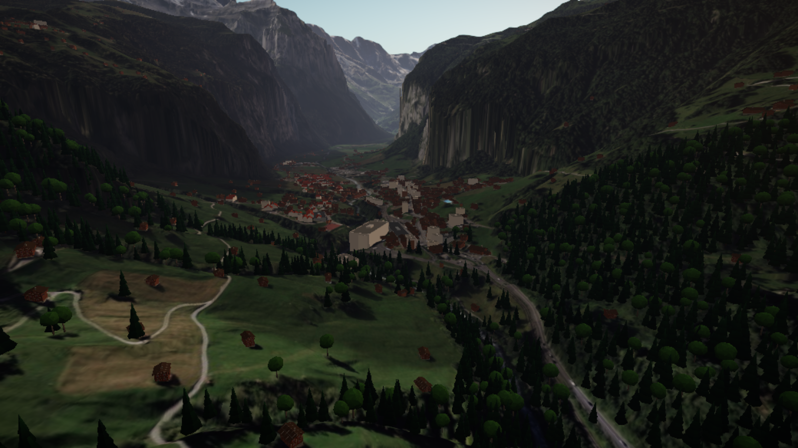

# Trapanotto Flight Simulator

Arcade-Flugsimulator im Browser über einer echten, gestreamten 3D-Schweiz.
Three.js · Geodaten von [geo.admin.ch](https://docs.geo.admin.ch/) (swisstopo) · Flugzeug aus Blender.

**Live:** https://trapanotto.github.io/flightsimulator/

## Stand

| Phase | Inhalt                                                | Status |
| ----- | ----------------------------------------------------- | ------ |
| 0     | Fundament: Projekt, CI, GitHub Pages, Startbildschirm | ✅     |
| 1     | Geo-Grundlagen & erstes Terrain                       | ⏳     |
| 2     | Streaming-Terrain (LOD, Floating Origin)              | ⏳     |
| 3     | Flugzeug aus Blender                                  | ⏳     |
| 4     | Flugmodell, Steuerung, Kameras                        | ⏳     |
| 5     | Grafik-Politur                                        | ⏳     |
| 6     | Gebäude, HUD & UI                                     | ⏳     |
| 7     | Gameplay & Audio                                      | ⏳     |
| 8     | Release 1.0                                           | ⏳     |

Das vollständige Konzept steht in [docs/KONZEPT.md](docs/KONZEPT.md).


## Was schon geht

- **HUD:** Kompassband, künstlicher Horizont mit Nickleiter, nächster Ortsname, Minimap aus der
  Landeskarte (M = gross), Suche nach jedem Ort der Schweiz (geo.admin.ch SearchServer).
  

- **Regionstypische Gebäude und Bäume**, in Blender modelliert und auf die swisstopo-Grundrisse
  und Waldflächen gesetzt: Berner Bauernhaus, Chalet, Walliser Holzhaus, Engadiner Haus, Tessiner
  Rustico und Wohnhaus, Mehrfamilienhaus, Block, Halle, Kirchen; Fichte, Tanne, Lärche, Arve, Buche,
  Kastanie nach Höhe und Region ([Konzept](docs/KONZEPT-PHASE6.md)).
  

- **Grafik:** Sonnenstand nach Datum und Uhrzeit, Luftperspektive, Wolkendecke mit Wolkenschatten,
  Schnee in der Höhe, Flugzeugschatten, Kondensstreifen, Bloom, SMAA, Sonnen-Glanzlicht;
  vier Qualitätsstufen (automatisch nach GPU), Einstellungen für Grafik, Tageszeit und Wetter.
  Messwerte: [docs/BENCHMARK.md](docs/BENCHMARK.md).
- **Fliegen** mit dem TR-1: Arcade-Flugmodell (Start, Kurvenflug, sanfter Strömungsabriss, Landung
  mit Bewertung, Absturz mit Neustart in der Luft), Start auf sechs echten Pisten
  (Bern-Belp, Sion, Zürich, Samedan, Lugano, Genf) oder in der Luft über Lauterbrunnen und am Matterhorn.
  Steuerung per Tastatur, Maus («fliege, wohin du schaust»), Gamepad oder Touch; Kameras
  Verfolger, Cockpit, Flügel, Orbit.
- **Flugzeug TR-1 «Alpenfalke»** – komplett per Python-Skript in Blender erzeugt: Rumpf aus Querschnitten,
  NACA-Profile, bewegliche Ruder, Klappen, Fahrwerk, 4-Blatt-Propeller, Cockpit; Lackierung und
  Schriftzüge in einer 2048er-Textur; drei Detailstufen; 0,7 MB als GLB. Im Spiel unter **Hangar**.

- **Ganze Schweiz streamen:** Terrain (Quantized-Mesh) und SWISSIMAGE-Luftbilder direkt von geo.admin.ch,
  Detail nach Bildschirmfehler (Quadtree, Zoom 7–15), Vorausladen in Flugrichtung, Speicherbudget
- **Freie Flugkamera** mit Startorten (Genf, Bern, Zürich, Lauterbrunnen, Matterhorn, St. Moritz)
  und automatischem Testflug Genf → St. Moritz
- **Floating Origin:** keine Zitterbewegungen, egal wo man in der Schweiz ist
- **Höhe über Grund** aus einem Höhenraster pro Kachel; die Kamera kann nicht mehr durch Berge fliegen
- **Dynamische Auflösung:** wird es eng, rechnet das Spiel mit etwas weniger Pixeln
- Debug-Anzeige mit `F3` (oder `?debug` in der URL)

### Steuerung (Fliegen)

| Aktion                | Tastatur                         | Gamepad                     |
| --------------------- | -------------------------------- | --------------------------- |
| Nase runter / rauf    | W / S oder ↑ / ↓                 | linker Stick vor / zurück   |
| Rollen                | A / D oder ← / →                 | linker Stick links / rechts |
| Gieren                | Q / E                            | LB / RB                     |
| Schub + / −           | Shift / Ctrl (oder R / F)        | RT / LT                     |
| Boost                 | Leertaste                        | A                           |
| Fahrwerk / Klappen    | G / V                            | X / Steuerkreuz             |
| Bremse                | B                                | B                           |
| Kamera                | C                                | Y                           |
| Maus-Steuerung an/aus | M (Klick ins Bild aktiviert sie) | –                           |
| Pause / Neustart      | P / Backspace                    | Start / Back                |


### Steuerung (freie Kamera)

| Aktion                     | Eingabe                                     |
| -------------------------- | ------------------------------------------- |
| Umschauen                  | Maus ziehen / Pfeiltasten                   |
| Vor / zurück / seitwärts   | W / S / A / D                               |
| Hoch / runter              | E oder Leertaste / Q                        |
| Schneller / langsamer      | Shift / Ctrl, Mausrad ändert das Grundtempo |
| Orte                       | 1–6                                         |
| Testflug Genf → St. Moritz | R                                           |
| Touch                      | Ziehen zum Umschauen, «Vorwärts»-Knopf      |

## Flugzeug neu bauen

Braucht Blender 5.x im `PATH`. Erzeugt Modell, Texturen, Vorschaubilder (`build/`) und
`public/assets/aircraft/tr1.glb`:

```bash
npm run assets
```

Renderbild für Startbildschirm und Link-Vorschau (Hintergrund ist ein Screenshot der eigenen Engine):

```bash
AFTER=30000 node tools/screenshot.mjs "http://localhost:5180/flightsimulator/" build/hero_bg.png 2000 "document.querySelector('[data-action=preview]').click(); setTimeout(() => document.querySelectorAll('.world-ui').forEach(e => e.style.display='none'), 1500)"
```

```bash
blender -b build/tr1.blend -P tools/blender/render_hero.py
```

## Entwickeln

```bash
npm install
npm run dev      # Entwicklungsserver
npm run lint     # ESLint
npm test         # Vitest
npm run build    # Produktions-Build nach dist/
npm run test:route   # 2-Minuten-Testflug (Streaming)
npm run test:flight  # Abnahme Phase 4: Start Bern, Lauterbrunnen, Landung Sion in headless Edge/Chrome, braucht laufenden Dev-Server auf Port 5180
```

Jeder Push auf `main` wird per GitHub Actions gebaut, getestet und auf GitHub Pages veröffentlicht.

## Credits & Lizenz

- Geodaten: © swisstopo (Bundesamt für Landestopografie), gestreamt über geo.admin.ch. Die Daten sind nicht Teil dieses Repos.
- Code: MIT, siehe [LICENSE](LICENSE). 3D-Modelle, Texturen und Renderbilder: CC BY 4.0.
- Schrift im Flugzeug-Schriftzug: Liberation Sans Bold (SIL Open Font License).
