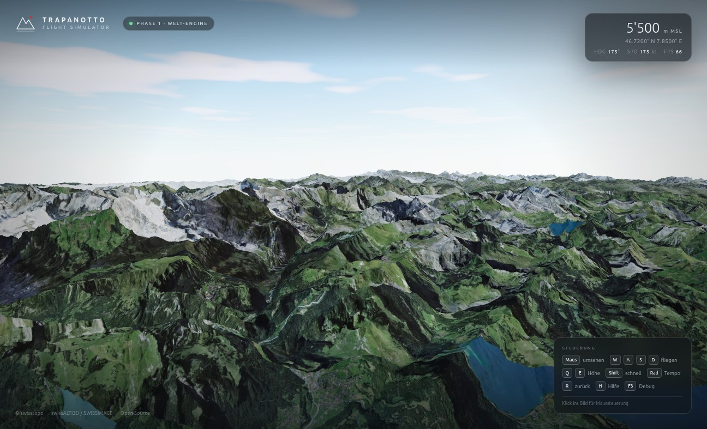

# Trapanotto Flight Simulator

> **Die Schweiz aus der Luft.** Ein browserbasierter Flugsimulator mit echten
> swisstopo-Geodaten, Three.js und Blender-Assets. Kein Download, kein Launcher
> — ein Link genügt.

[](https://github.com/Trapanotto/flightsimulator/actions/workflows/deploy.yml)
[](#status)
[](#technik)
[](#lizenz)

**Live-Demo:** https://trapanotto.github.io/flightsimulator/



*Phase 1: swissALTI3D-Terrain und SWISSIMAGE-Orthofotos über dem Berner
Oberland, Blick Richtung Eiger, Mönch und Jungfrau.*

---

## Status

**Phase 0 — Konzept abgeschlossen.** Die vollständige Produkt- und
Technikspezifikation steht in **[KONZEPT.md](./KONZEPT.md)**.

**Phase 1 — Welt-Engine läuft.** Terrain-Streaming, Orthofotos, LOD und freie
Kamera sind implementiert und auf GitHub Pages deploybar.

| Phase | Inhalt | Status |
|---|---|---|
| 0 | Konzept, Datenquellen, Architektur | ✅ |
| 1 | Fundament & Welt (Terrain, Orthofotos, Streaming) | 🟡 live, Feinschliff offen |
| 2 | Flugzeug & Flugmodell | ⏳ |
| 3 | Cockpit & Avionik | ⏳ |
| 4 | Flugplätze & Szenerie | ⏳ |
| 5 | Wetter & Atmosphäre | ⏳ |
| 6 | UX & Missionen | ⏳ |
| 7 | Polish & Launch v1.0 | ⏳ |

### Was jetzt schon geht

- [x] Quantized-Mesh-Terrain-Streaming von swissALTI3D
- [x] SWISSIMAGE-Orthofotos, korrekt auf EPSG:4326-Terrain gedrapt
- [x] LOD-Quadtree mit Screen-Space-Error, Frustum Culling und Skirts
- [x] Terrain- und Imagery-Decoding in Web Workern
- [x] IndexedDB-freier In-Memory-Cache + HTTP-Cache
- [x] Freie Kamera (Maus, Tastatur, Pointer Lock, Drag-Fallback)
- [x] Dynamischer Himmel mit Sonne, Wolken und Atmosphäre
- [x] Debug-Overlay (F3): Tiles, Dreiecke, Draw Calls, Frame-Zeit
- [x] Unit-Tests für Geodäsie und Quantized-Mesh-Decoder
- [x] GitHub Actions CI/CD → GitHub Pages

### Was noch fehlt (Phase 1 Feinschliff)

- [ ] Mini-Map mit Flugplatz-Markern
- [ ] IndexedDB-Persistenz für Terrain und Bilder
- [ ] LOD-Nahtstellen weiter glätten
- [ ] Weitere Qualitäts-Presets und automatische Geräteerkennung
- [ ] E2E-Smoke-Test mit Playwright

---

## Steuerung

| Eingabe | Funktion |
|---|---|
| **Maus** | Umsehen (Klick ins Bild = Pointer Lock; Ziehen = Fallback) |
| **W A S D** | Vorwärts / links / rückwärts / rechts |
| **Q / E** | Sinken / Steigen |
| **Shift** | 5× schneller |
| **Strg** | 0,2× langsamer |
| **Mausrad** | Tempo stufenlos |
| **R** | Zur Startposition zurück |
| **H** | Hilfe ein/aus |
| **F3** | Debug-Overlay ein/aus |
| **ESC** | Pointer Lock freigeben |

Die Kamera ist noch kein Flugzeug — Phase 2 bringt den TFS-172 mit
Flugmodell, Start, Landung und Cockpit.

### URL-Parameter (praktisch für Screenshots und QA)

```text
?lat=46.72&lon=7.85&alt=5500&hdg=175&pitch=-8
?debug
```

- `lat`, `lon`: Grad
- `alt`: Höhe in Metern MSL
- `hdg`: Heading in Grad (0 = Norden)
- `pitch`: Blickneigung in Grad (negativ = nach unten)
- `debug`: Debug-Overlay sofort anzeigen

---

## Technik

- **Three.js** (WebGL2) für Rendering und Szene
- **TypeScript + Vite** für Entwicklung und Build
- **swissALTI3D Terrain** als Cesium Quantized Mesh 1.0
- **SWISSIMAGE** als WMTS-Orthofotos (EPSG:3857)
- **Web Worker** für Terrain-Decoding und Bildkomposition
- **proj4js** für LV95 ↔ WGS84
- **Vitest** für Unit-Tests
- **GitHub Actions** für CI/CD und Pages

Kein CesiumJS, kein React, kein Backend, kein Tracking.

### Architektur in 30 Sekunden

```text
swisstopo WMTS ──► Imagery-Worker ──► Canvas-Atlas ──► Terrain-Textur
swisstopo Terrain ─► Terrain-Worker ─► ENU-Mesh ─────► Three.js-Szene
                                        ▲
Quadtree (SSE, Frustum, Skirts) ────────┘
```

Mehr Details: **[KONZEPT.md](./KONZEPT.md)** und
**[ADR 0001](./docs/adr/0001-phase1-world-engine.md)**.

---

## Entwicklung

```bash
npm install
npm run dev        # http://127.0.0.1:5173/flightsimulator/
npm run build      # Produktionsbuild nach dist/
npm run preview    # Produktionsbuild lokal testen
npm run typecheck  # TypeScript
npm test           # Unit-Tests
```

Voraussetzungen: Node.js 22+, ein aktueller Browser mit WebGL2 und
Internetverbindung (die Geodaten werden live geladen).

### Projektstruktur

```text
src/
  app/        App-Controller, Kamera, Atmosphäre
  geo/        WGS84, ECEF, ENU, LV95, Tile-Mathematik
  terrain/    Provider, Decoder, Mesh-Builder, Quadtree, Loader
  workers/    Terrain- und Imagery-Worker
  ui/         HUD, Laden, Debug, Attribution
  styles.css  Designsystem
tests/        Unit-Tests + Terrain-Fixture
docs/         ADRs, Screenshots
tools/        Blender- und Daten-Pipelines (Phase 2+)
```

---

## Datenquellen und Attribution

| Quelle | Verwendung | Lizenz |
|---|---|---|
| [swisstopo](https://www.swisstopo.admin.ch) | swissALTI3D, SWISSIMAGE | OGD, Quellenangabe |
| [OpenStreetMap](https://www.openstreetmap.org) | Rollwege, Seen, Landmarken (geplant) | ODbL |
| [OurAirports](https://ourairports.com) | Pisten, Frequenzen (geplant) | Public Domain |
| [Open-Meteo](https://open-meteo.com) | Live-Wetter (geplant) | CC BY 4.0 |

**© swisstopo** · **© OpenStreetMap contributors** · Weather data by Open-Meteo.com

Die Geodaten werden zur Laufzeit direkt vom Browser gestreamt und sind nicht
Teil dieses Repositories (Ausnahme: eine kleine Test-Kachel). Details:
**[ATTRIBUTION.md](./ATTRIBUTION.md)**.

Dieses Projekt steht in keiner Verbindung zu Microsoft oder Microsoft Flight
Simulator. Es ist ein unabhängiges Open-Source-Projekt.

---

## Roadmap

| Phase | Ziel | Highlight |
|---|---|---|
| 1 | Welt-Engine | Matterhorn aus dem Browser |
| 2 | Flugzeug & Physik | TFS-172, Start und Landung |
| 3 | Cockpit & Avionik | PFD, MFD, GPS, Autopilot |
| 4 | Flugplätze & Szenerie | LSZH, LSGG, LSZB, Gebäude, Seen |
| 5 | Wetter & Atmosphäre | Live-Wetter, Wolken, Tag/Nacht |
| 6 | UX & Missionen | Tutorial, 10 Missionen, Foto-Modus |
| 7 | Launch v1.0 | Performance, QA, Release |

Details und Abnahmekriterien: **[KONZEPT.md](./KONZEPT.md)**.

---

## Lizenz

- Code: **MIT** (siehe [LICENSE](./LICENSE))
- Eigene Assets: **CC BY 4.0** (sofern nicht anders angegeben)
- swisstopo-Daten: Nutzungsbedingungen von swisstopo
- OpenStreetMap: ODbL
- Open-Meteo: CC BY 4.0

---

**Nächster Meilenstein:** Phase 1 abschließen (Mini-Map, Cache, Nahtstellen)
und mit Phase 2 — TFS-172 in Blender und Flugmodell — beginnen.
