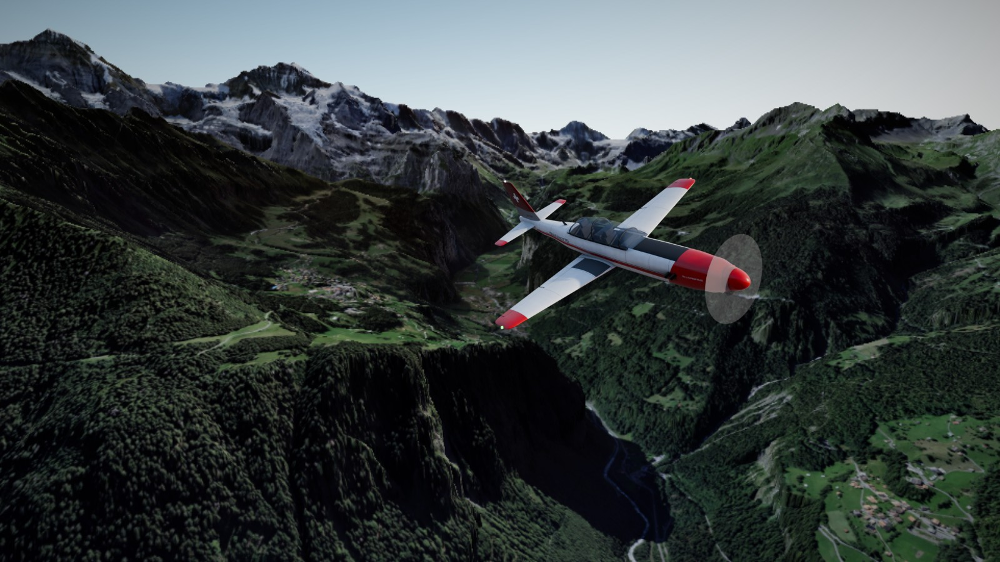
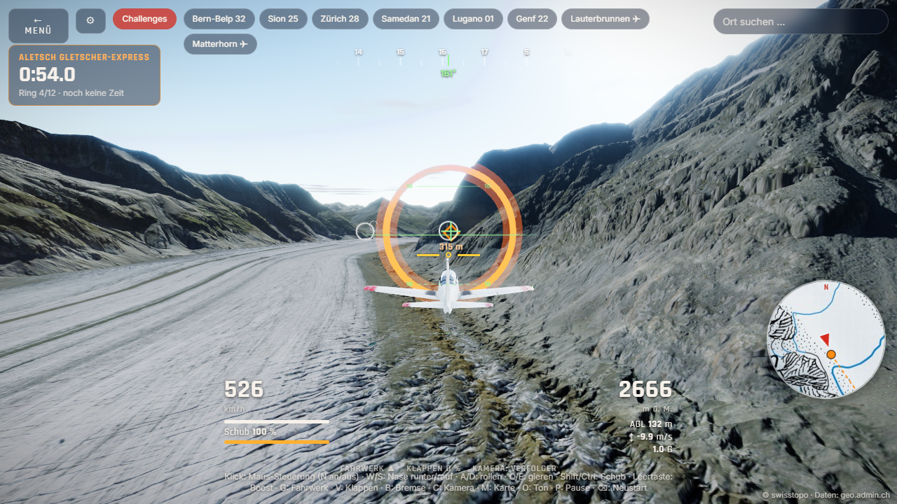
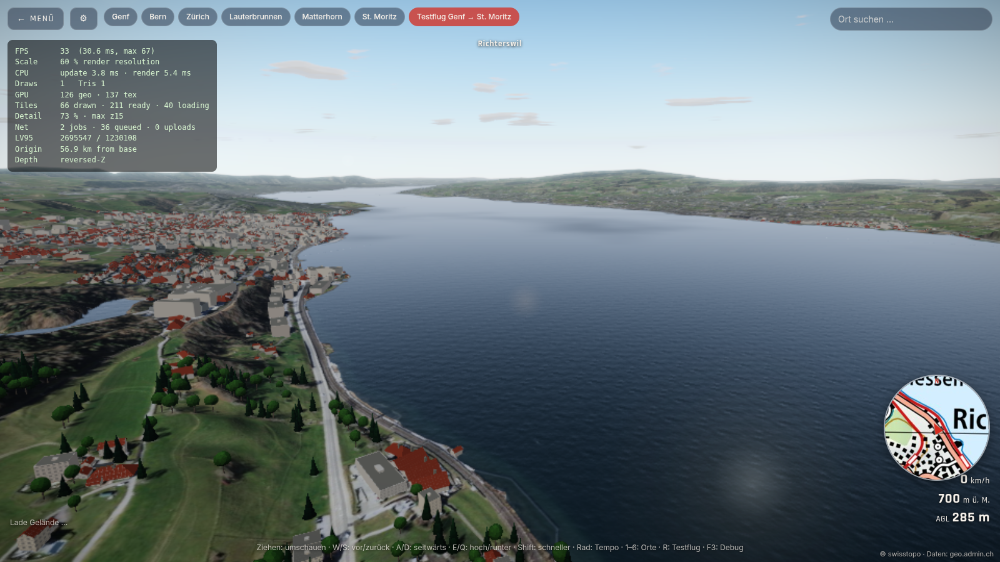
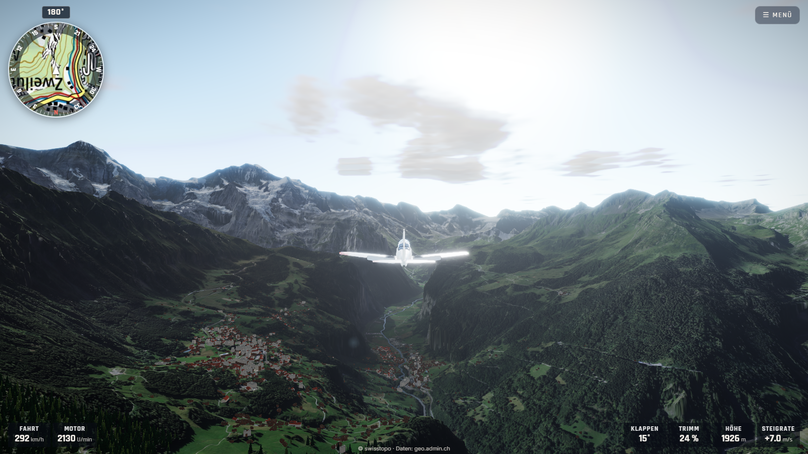
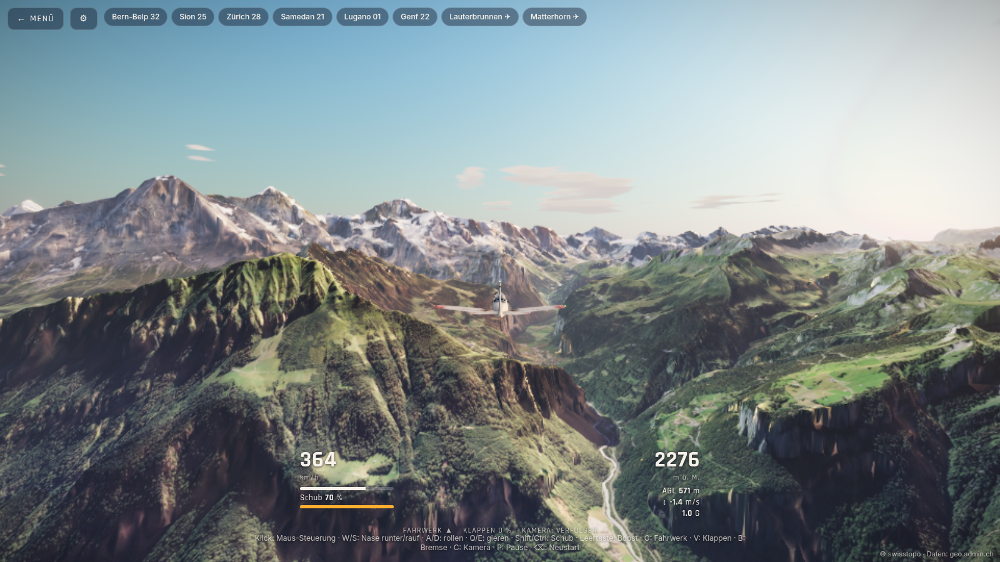
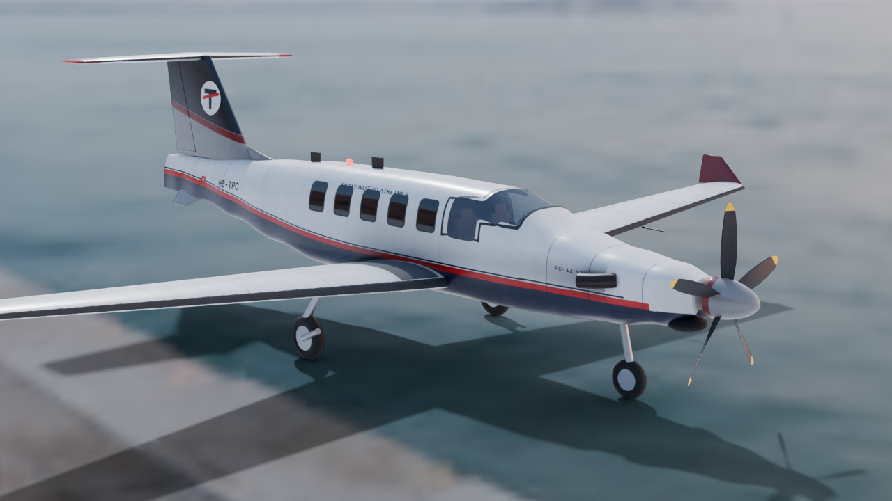
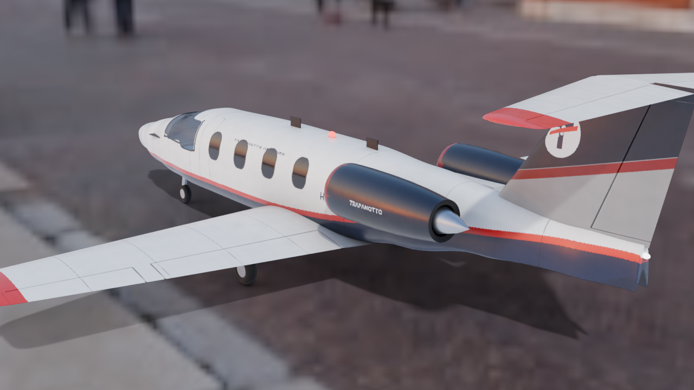
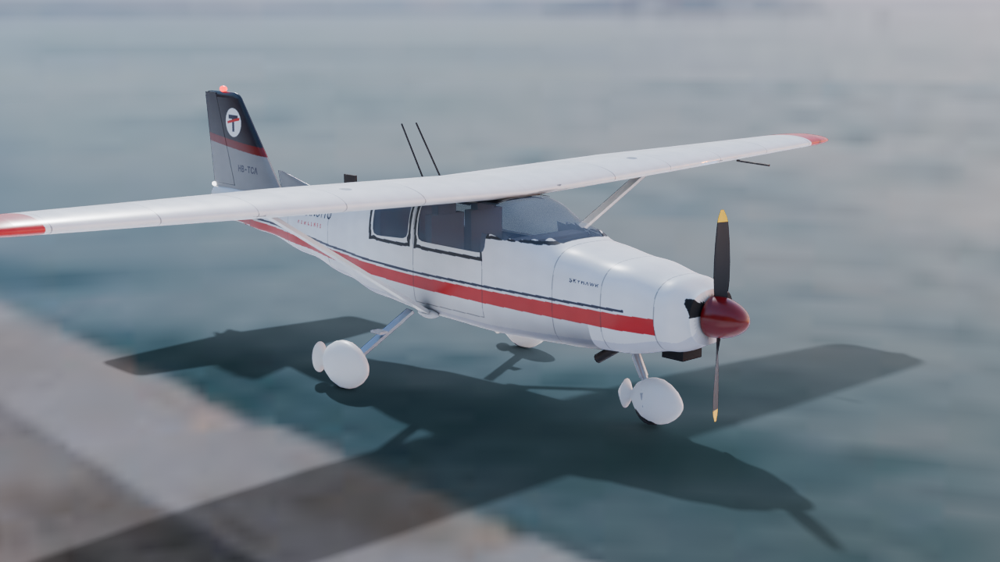
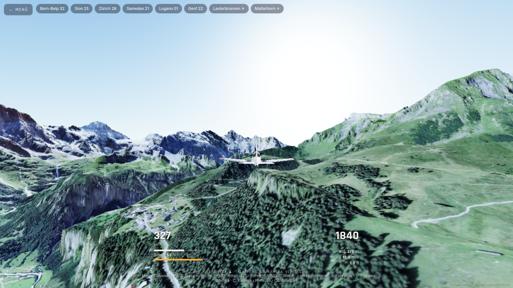

# Trapanotto Flight Simulator

Arcade-Flugsimulator im Browser über einer echten, gestreamten 3D-Schweiz.
Three.js · Geodaten von [geo.admin.ch](https://docs.geo.admin.ch/) (swisstopo) · Flugzeug aus Blender.

**Live:** https://trapanotto.github.io/flightsimulator/

## Stand

| Phase | Inhalt                                                | Status                  |
| ----- | ----------------------------------------------------- | ----------------------- |
| 0     | Fundament: Projekt, CI, GitHub Pages, Startbildschirm | ✅                      |
| 1     | Geo-Grundlagen & erstes Terrain                       | ✅                      |
| 2     | Streaming-Terrain (LOD, Floating Origin)              | ✅                      |
| 3     | Flugzeug aus Blender                                  | ✅                      |
| 4     | Flugmodell, Steuerung, Kameras                        | ✅                      |
| 5     | Grafik-Politur                                        | ✅                      |
| 6     | Gebäude, HUD & UI                                     | ✅                      |
| 7     | Gameplay & Audio                                      | 🏁 Challenges, Audio ✅ |
| 8     | Release 1.0                                           | ⏳                      |

Das vollständige Konzept steht in [docs/KONZEPT.md](docs/KONZEPT.md).



## Was schon geht

- **Ring-Challenges:** fünf Strecken mit Zeitmessung, Medaillen (Gold/Silber/Bronze) und Bestzeiten
  im Browser – Lauterbrunnen Canyon Run, Matterhorn-Umrundung, Aletsch Gletscher-Express,
  Seen-Tour Zentralschweiz und Landeanflug Samedan (endet mit Landung auf Piste 03).
  Die Ringe sind gegen das swisstopo-Höhenmodell geplant: jeder liegt 90–150 m über Grund, und die
  Linie zwischen zwei Ringen ist frei. Nach einem Absturz geht es beim letzten Ring weiter.
  Direktstart per Link, z. B. `#challenge=aletsch`.
  

- **Echte Wasserflächen:** Seen und Flüsse aus den swisstopo-Vektorkacheln (Gewässer aus swissTLM3D)
  werden als Maske in die Luftbild-Kacheln gezeichnet; der Shader macht daraus Wasser mit Wellen,
  Himmelsspiegelung (Fresnel) und Sonnenglanz.
  

- **Ton:** komplett synthetisch mit WebAudio – Turboprop, Wind, Boost, PULL-UP/STALL-Warnungen,
  Aufsetzen und Absturz, Doppler in den Aussenkameras (O = Ton aus).

- **HUD** im Stil des Microsoft Flight Simulator: oben links die Landeskarte in Flugrichtung mit
  Kompassring und Kurs (M = gross), unten links Fahrt und Motordrehzahl, unten rechts Klappen,
  Trimm, Höhe und Steigrate, oben rechts das Menü mit Startorten, Ortssuche (geo.admin.ch
  SearchServer), Challenges, Einstellungen und Tastenbelegung.
  
- **Trimm:** Knüppel loslassen hält die aktuelle Nicklage; Bild↑/Bild↓ verstellt sie freihändig.

- **Regionstypische Gebäude und Bäume**, in Blender modelliert und auf die swisstopo-Grundrisse
  und Waldflächen gesetzt: Berner Bauernhaus, Chalet, Walliser Holzhaus, Engadiner Haus, Tessiner
  Rustico und Wohnhaus, Mehrfamilienhaus, Block, Halle, Kirchen; Fichte, Tanne, Lärche, Arve, Buche,
  Kastanie nach Höhe und Region ([Konzept](docs/KONZEPT-PHASE6.md)).
  

- **Grafik:** Sonnenstand nach Datum und Uhrzeit, Luftperspektive, Wolkendecke mit Wolkenschatten,
  Schnee in der Höhe, Flugzeugschatten, Kondensstreifen, Bloom, SMAA, Sonnen-Glanzlicht;
  vier Qualitätsstufen (automatisch nach GPU), Einstellungen für Grafik, Tageszeit und Wetter.
  Messwerte: [docs/BENCHMARK.md](docs/BENCHMARK.md).
- **Fliegen** mit der Flotte von Trapanotto Airlines: Arcade-Flugmodell mit eigenen Werten je Typ (Start, Kurvenflug, sanfter Strömungsabriss, Landung
  mit Bewertung, Absturz mit Neustart in der Luft), Start auf sechs echten Pisten
  (Bern-Belp, Sion, Zürich, Samedan, Lugano, Genf) oder in der Luft über Lauterbrunnen und am Matterhorn.
  Steuerung per Tastatur, Maus («fliege, wohin du schaust»), Gamepad oder Touch; Kameras
  Verfolger, Cockpit, Flügel, Orbit.
- **Flotte «Trapanotto Airlines»** – jedes Flugzeug komplett per Python-Skript in Blender erzeugt
  (`tools/blender/types/<typ>.py` auf einer gemeinsamen Bibliothek in `tools/blender/ac/`):
  Rumpf aus Querschnitten mit echten Fensteröffnungen und Kabine, NACA-Profile, bewegliche Ruder
  und Klappen, Fahrwerk, Propeller bzw. Triebwerke, Lackierung mit Logo und Schriftzug in einer
  2048er-Textur, drei Detailstufen. Auswahl im **Hangar** oder im Flugmenü.
  - ✅ **Cessna 172 Skyhawk** (HB-TCA): Hochdecker mit Streben, starres Fahrwerk mit Radverkleidungen,
    Glascockpit; Challenge «Seen-Tour Zentralschweiz»; 0,8 MB.
  - ✅ **Pilatus PC-12 NGX** (HB-TPC): Tiefdecker aus Stans, T-Leitwerk, Winglets, 5-Blatt-Propeller,
    Einziehfahrwerk; Challenge «Lauterbrunnen Canyon Run»; 0,8 MB.
    
  - ✅ **Embraer Phenom 100** (HB-TEP): Businessjet mit gepfeiltem Flügel, T-Leitwerk und zwei
    Heck-Turbofans (drehender Fan); Challenge «Aletsch Gletscher-Express»; 0,8 MB.
    
  - ⏳ Lockheed Martin F-35 Lightning II, Airbus A320, Boeing 747
    

- **Ganze Schweiz streamen:** Terrain (Quantized-Mesh) und SWISSIMAGE-Luftbilder direkt von geo.admin.ch,
  Detail nach Bildschirmfehler (Quadtree, Zoom 7–15), Vorausladen in Flugrichtung, Speicherbudget
- **Freie Flugkamera** mit Startorten (Genf, Bern, Zürich, Lauterbrunnen, Matterhorn, St. Moritz)
  und automatischem Testflug Genf → St. Moritz
- **Floating Origin:** keine Zitterbewegungen, egal wo man in der Schweiz ist
- **Höhe über Grund** aus einem Höhenraster pro Kachel; die Kamera kann nicht mehr durch Berge fliegen
- **Volle Auflösung:** immer scharf in der nativen Bildschirmauflösung (bis Pixelrate 2), kein Herunterskalieren
- Debug-Anzeige mit `F3` (oder `?debug` in der URL)

### Steuerung (Fliegen)

| Aktion                   | Tastatur                           | Gamepad                     |
| ------------------------ | ---------------------------------- | --------------------------- |
| Nase runter / rauf       | W / S oder ↑ / ↓                   | linker Stick vor / zurück   |
| Rollen                   | A / D oder ← / →                   | linker Stick links / rechts |
| Gieren                   | Q / E                              | LB / RB                     |
| Schub + / −              | Shift / Ctrl (oder R / F)          | RT / LT                     |
| Boost                    | Leertaste                          | A                           |
| Fahrwerk / Klappen       | G / V                              | X / Steuerkreuz             |
| Trimm Nase runter / rauf | Bild↑ / Bild↓ (Ziffernblock 7 / 1) | –                           |
| Bremse                   | B                                  | B                           |
| Kamera                   | C                                  | Y                           |
| Maus-Steuerung an/aus    | N (Klick ins Bild aktiviert sie)   | –                           |
| Karte gross / klein      | M                                  | –                           |
| Ton an / aus             | O                                  | –                           |
| Pause / Neustart         | P / Backspace                      | Start / Back                |



### Steuerung (freie Kamera)

| Aktion                     | Eingabe                                     |
| -------------------------- | ------------------------------------------- |
| Umschauen                  | Maus ziehen / Pfeiltasten                   |
| Vor / zurück / seitwärts   | W / S / A / D                               |
| Hoch / runter              | E oder Leertaste / Q                        |
| Schneller / langsamer      | Shift / Ctrl, Mausrad ändert das Grundtempo |
| Orte                       | 1–6                                         |
| Testflug Genf → St. Moritz | R                                           |
| Touch                      | Ziehen zum Umschauen, «Vorwärts»-Knopf      |

## Flugzeug neu bauen

Braucht Blender 5.x (im `PATH`, unter `$BLENDER` oder am Windows-Standardort). Erzeugt Modell,
Texturen, Vorschaubilder (`build/`) und `public/assets/aircraft/<typ>.glb` – ohne Typ die ganze Flotte:

```bash
npm run assets -- c172 -- --preview
```

Renderbild für Startbildschirm und Link-Vorschau (Hintergrund ist ein Screenshot der eigenen Engine):

```bash
AFTER=30000 node tools/screenshot.mjs "http://localhost:5180/flightsimulator/" build/hero_bg.png 2000 "document.querySelector('[data-action=preview]').click(); setTimeout(() => document.querySelectorAll('.world-ui').forEach(e => e.style.display='none'), 1500)"
```

```bash
blender -b build/c172.blend -P tools/blender/render_hero.py
```

## Entwickeln

```bash
npm install
npm run dev      # Entwicklungsserver
npm run lint     # ESLint
npm test         # Vitest
npm run build    # Produktions-Build nach dist/
npm run test:route   # 2-Minuten-Testflug (Streaming)
npm run test:flight  # Abnahme Phase 4: Start Bern, Lauterbrunnen, Landung Sion in headless Edge/Chrome, braucht laufenden Dev-Server auf Port 5180
```

Jeder Push auf `main` wird per GitHub Actions gebaut, getestet und auf GitHub Pages veröffentlicht.

## Credits & Lizenz

- Geodaten: © swisstopo (Bundesamt für Landestopografie), gestreamt über geo.admin.ch. Die Daten sind nicht Teil dieses Repos.
- Code: MIT, siehe [LICENSE](LICENSE). 3D-Modelle, Texturen und Renderbilder: CC BY 4.0.
- Schrift im Flugzeug-Schriftzug: Liberation Sans Bold (SIL Open Font License).
